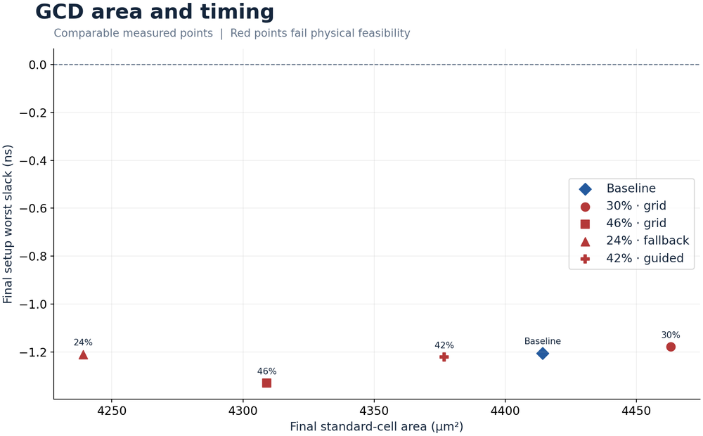

# AUTONOMOUS-EDA

AUTONOMOUS-EDA provides a deterministic Python controller for reproducible RTL-to-GDSII experiments using OpenROAD Flow Scripts (ORFS). It includes Environment Doctor, ordered RTL inspection, staged physical implementation, checkpoint recovery, and artifact-linked evidence. The built-in configurations target GCD and Ibex on SkyWater 130 HD. The long-term benchmark is OpenTitan Earl Grey 2.

With Python 3.11 or newer, run `python -m pip install -e .`, then `autonomous-eda doctor`. See the [Environment Doctor guide](docs/ENVIRONMENT_DOCTOR.md) for JSON output, exit codes, and the Windows/WSL2 workflow.

```sh
autonomous-eda inspect examples/counter.toml
autonomous-eda plan configs/gcd-sky130hd.toml
autonomous-eda run configs/gcd-sky130hd.toml experiments/gcd-run --memory-mib 1200
autonomous-eda verify experiments/gcd-run
autonomous-eda resume experiments/gcd-run
autonomous-eda report experiments/gcd-run
```

RTL inspection uses a local Yosys executable. Physical execution and deck verification use the locally cached pinned image with Docker on Linux or WSL2. A successful `run` or `resume` means the stage plan completed. Use `verify RUN --profile full` for configured acceptance and `report RUN --profile full --markdown` for the decision and its evidence. The standalone `verify RUN` command runs platform DRC and LVS. See the [verification guide](docs/VERIFICATION_AND_ACCEPTANCE.md).

Install the optional MCP extra with `python -m pip install -e '.[mcp]'`. Run `autonomous-eda mcp inspect --config mcp.toml` to discover the local server's tools. The [MCP guide](docs/MCP.md) includes the experiment allowlist, stdio client configuration, and CLI reference.

Use `autonomous-eda knowledge --help` to index approved reports, documentation, and experiment evidence for local keyword, semantic, or hybrid search. The [knowledge guide](docs/KNOWLEDGE.md) covers registration, citations, and the optional CPU embedding model.

Use `autonomous-eda ai --help` for deterministic observation, model-assisted explanation, and durable replay of approved experiments. The [AI supervisor guide](docs/AI_SUPERVISOR.md) covers the CLI and local model setup.

## Example Results




The GCD reference and four optimization candidates completed physical implementation. All missed the original 1.1 ns setup constraint. The [example gallery](docs/EXAMPLE_GALLERY.md) links the retained Ibex results, independent verification states and figure provenance.

```sh
python -m pip install -e '.[visuals]'
autonomous-eda artifacts render .local/diagnosis-reference/gcd --all
autonomous-eda artifacts render experiments/optimization-gcd-m8 --all
```

See the [optimization commands](docs/OPTIMIZATION.md) to plan, approve and reproduce a bounded campaign.

See the [architecture](docs/ARCHITECTURE.md), [roadmap](docs/ROADMAP.md), [project state](docs/PROJECT_STATE.md), and [experiment protocol](docs/EXPERIMENT_PROTOCOL.md).
