# AUTONOMOUS-EDA

AUTONOMOUS-EDA runs reproducible register-transfer level (RTL) to GDSII experiments with Python and pinned OpenROAD Flow Scripts (ORFS). It resolves inputs, dispatches a fixed flow, preserves failed attempts, checks artifact hashes and evaluates independent verification gates. Yosys synthesizes logic, OpenROAD implements it, OpenRCX extracts parasitics, OpenSTA performs static timing analysis (STA), and KLayout handles stream-out and applicable physical verification. The operator controls designs, constraints, budgets and corrective dispatch.

Sky130HD GCD and Ibex reached final layout at their original clocks and missed setup. OpenTitan AES reached global routing. Milestone 12B verified five native functional scenarios and bounded key/IV status proofs. Full sequential equivalence, production interface timing and final physical acceptance remain blocked at readiness Level 2.

## Engineering capabilities

| Capability | Status | Evidence and scope |
| --- | --- | --- |
| Ordered RTL ingestion, hierarchy and regressions | Experimentally validated | Native Yosys and Icarus fixtures, plus pinned FuseSoC/EDAM and sv2v for OpenTitan AES |
| Core implementation, recovery and GDSII export | Experimentally validated | Seven controller stages and independent GDSII reopening for GCD and Ibex |
| Independent coverage, design rule checking (DRC), layout versus schematic (LVS) and STA | Experimentally validated | GCD passed coverage, DRC, LVS and hold, and failed final setup at 1.1 ns |
| Reports, telemetry, Studio and read-only Model Context Protocol (MCP) | Experimentally validated | Recorded CLI, browser and SDK stdio |
| Budgeted search and AI interpretation | Implemented | Operator-reviewed GCD search and model explanations from verified evidence |
| OpenTitan AES and macro readiness | Partially qualified | Mapped AES, verified partial physical checkpoints and scoped regressions. DFFRAM Liberty qualification remains open. |
| Full-chip acceptance | Blocked | IO placement and selected signal routes demonstrated. Chip power, deck, timing and electrical gates remain unresolved. |
| General sequential proof, multi-corner signoff and whole-chip OpenTitan implementation | Unsupported | Additional integration and qualified collateral are required. |

## Visual introduction

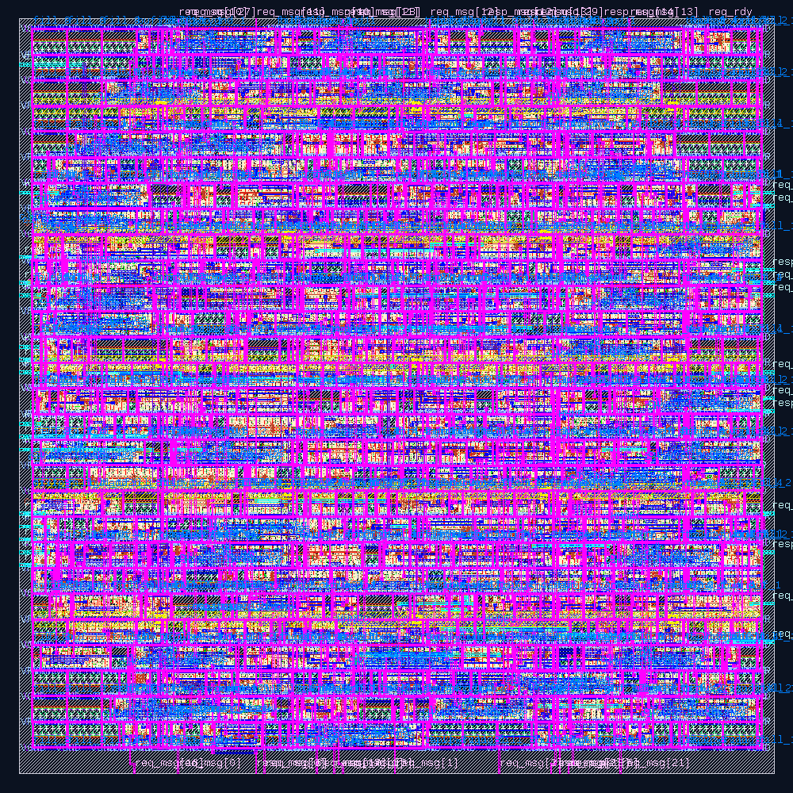

*GCD at 1.1 ns, run `b162fa09cf9442dda08b0b31cb58c728`. KLayout independently reopened the GDSII. Extracted setup failed at −1.20488 ns.* [Checkpoint provenance](docs/images/gcd-stage-snapshots/provenance.json) · [Gate matrix](docs/evidence/gcd-walkthrough/verification.txt)

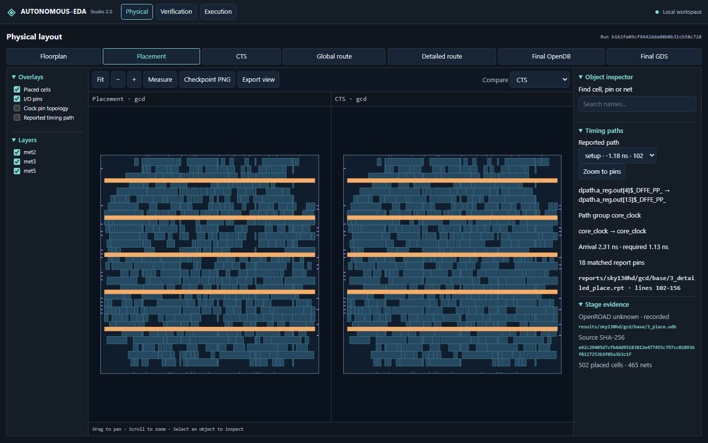

*Studio desktop compares verified GCD placement and clock-tree synthesis (CTS) checkpoints. The run later failed final setup.* [Browser receipt](docs/images/studio/provenance.json)

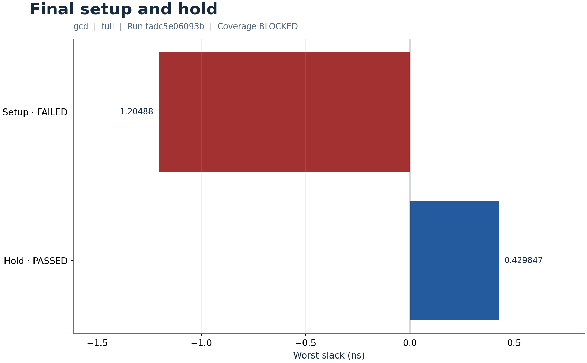

*Historical GCD at the same 1.1 ns Sky130HD target. The final setup result is −1.20488 ns and hold is +0.429847 ns.* [Timing figure provenance](docs/images/examples/verification-theme/provenance.json)

~~~mermaid
flowchart LR
    Inputs["Pinned inputs and operator policy"] --> Control["Controller"]
    Control --> Tools["ORFS tools"]
    Tools --> Store["Checkpoints, reports and SHA-256"]
    Store --> Verify["Independent gates"]
    Store --> View["Studio, MCP and optional AI"]
    Verify --> Review["Operator review"]
    View --> Review
    Review --> Trial["Approved isolated trial"]
    Trial --> Control
~~~

**Contents**

- [Engineering capabilities](#engineering-capabilities)
- [Visual introduction](#visual-introduction)
- [Installation and quickstart](#installation-and-quickstart)
- [RTL ingestion and elaboration](#rtl-ingestion-and-elaboration)
- [Functional and formal verification](#functional-and-formal-verification)
- [Complete physical flow](#complete-physical-flow)
- [Run and inspect GCD](#run-and-inspect-gcd)
- [Static timing analysis](#static-timing-analysis)
- [Physical verification and acceptance](#physical-verification-and-acceptance)
- [OpenTitan AES](#opentitan-aes)
- [Physical Design Studio](#physical-design-studio)
- [Agent and MCP guide](#agent-and-mcp-guide)
- [Optimization](#optimization)
- [CLI reference](#cli-reference)
- [Troubleshooting](#troubleshooting)
- [Resource planning and recovery](#resource-planning-and-recovery)
- [Evidence store and native reports](#evidence-store-and-native-reports)
- [Results and benchmarks](#results-and-benchmarks)
- [Architecture and development](#architecture-and-development)

## Installation and quickstart

| Environment | Support and prerequisites |
| --- | --- |
| Windows PowerShell | Planning, evidence readback, existing Studio bundles and compatible host RTL tools. Install Git and Python 3.11+. For native RTL work add Yosys, Icarus Verilog and `vvp`. |
| Native Linux or WSL2 | Full pinned physical flow and rendering. Use Git, Python 3.11+ with `venv`, a reachable Linux/amd64 Docker daemon and a writable checkout accessible to the daemon. |
| Docker | The pinned ORFS image brings Yosys, OpenROAD, OpenSTA, KLayout, GNU Make and platform collateral. Doctor can also probe Podman. The controller workflow below dispatches with Docker. |
| Optional AI | Observation uses base Python. Install `knowledge` for CPU MiniLM dependencies and `mcp` for SDK stdio. Explanation needs an explicitly configured provider. |

### Linux and WSL2 setup

In Ubuntu 24.04, install the base utilities and native RTL tools as follows. With Docker Desktop, enable WSL integration for your selected distribution. With native Docker Engine, start the daemon and use an account that can access its socket. Run these commands from that Linux environment. Use a Linux filesystem for upstream sources with symlinks or byte-sensitive generated inputs. [Docker Desktop WSL integration](https://docs.docker.com/desktop/features/wsl/) · [Docker Engine for Ubuntu](https://docs.docker.com/engine/install/ubuntu/)

~~~sh
sudo apt-get update
sudo apt-get install git python3 python3-venv yosys iverilog

git clone https://github.com/wellitsabhinav/AUTONOMOUS-EDA.git
cd AUTONOMOUS-EDA
python3 -m venv .venv
. .venv/bin/activate
python -m pip install -e '.[visuals]'
autonomous-eda --version
python -m pip check

docker version
docker context show
orfs_image=openroad/orfs@sha256:8eff077230b86729f6248b34eeab370e486fa4052d34c60d9067e3e4aa720987
docker image inspect "$orfs_image" >/dev/null 2>&1 ||
  docker pull --platform linux/amd64 "$orfs_image"
docker image inspect "$orfs_image" --format '{{.Os}}/{{.Architecture}}'
autonomous-eda doctor --engine docker --workspace .
~~~

Expect `linux/amd64` and a passing image identity check. The pinned run uses the cached image offline. The recorded manual used WSL2 Ubuntu 24.04.5, Python 3.12.3, Docker 29.1.3, Make 4.4.1, Yosys 0.68+post and KLayout 0.30.12. OpenROAD returned version `unknown`. The image digest identifies the installed build.

~~~sh
# Optional extras
python -m pip install -e '.[mcp]'
python -m pip install -e '.[knowledge]'
python -m pip install -c .github/ci-constraints.txt -e '.[dev]'
~~~

### PowerShell setup for host-side work

~~~powershell
git clone https://github.com/wellitsabhinav/AUTONOMOUS-EDA.git
Set-Location AUTONOMOUS-EDA
py -3.12 -m venv .venv
.\.venv\Scripts\Activate.ps1
python -m pip install -e '.[visuals,mcp]'
autonomous-eda doctor --json
autonomous-eda plan configs/gcd-sky130hd.toml
Get-Command yosys,iverilog,vvp -ErrorAction SilentlyContinue
wsl --list --verbose
~~~

If execution policy prevents activation, install with `.\.venv\Scripts\python.exe -m pip` and invoke `.\.venv\Scripts\python.exe -m autonomous_eda`. Run Doctor again inside the target Linux distribution before building. Native Windows Icarus packages have exhibited helper-launch failures in paths with spaces. The measured RTL exercise uses Linux.

### Doctor and resource sizing

Doctor reports host resources, workspace capacity, engine access, cached image digest and architecture, bind readability, runnable tools, and required platform files. Defaults use the current directory and `sky130hd`. Use `--orfs-root` to probe local ORFS collateral. JSON reports each check's `required` flag, detail and remediation. Required FAIL gives exit 2. Required UNKNOWN, such as denied access or a timeout, gives exit 3. PASS and warnings alone give exit 0.

~~~sh
autonomous-eda doctor --json --engine docker --platform sky130hd --workspace .
docker info --format '{{.NCPU}} cores, {{.MemTotal}} bytes'
free -h
df -h .
~~~

The GCD example uses two tool threads, a 1,200 MiB container cap and 900 s per stage. Allow storage for the image, run outputs, preserved failures, verification and snapshots. WSL2 VM and Docker Desktop limits constrain what the daemon can allocate. Configure WSL2 CPU, RAM and swap in `%UserProfile%\.wslconfig` under `[wsl2]` via `processors`, `memory` and `swap` if needed. Choose values that leave headroom for Windows and other workloads. A WSL restart applies global values and stops active distributions. Check `free -h` and `docker info` inside your distribution afterward. The measured AES trials used 3,000 MiB and zero extra container swap. Completion memory and runtime remain unknown. [Doctor checks](docs/ENVIRONMENT_DOCTOR.md) · [AES resource receipts](docs/evidence/opentitan-aes/bounded-route.json)

## RTL ingestion and elaboration

The repository's `examples/counter.toml` points to `examples/rtl/counter.sv`. It declares a top and ordered sources relative to the manifest.

~~~toml
schema_version = 1
backend = "yosys"
top = "counter"
sources = ["rtl/counter.sv"]
~~~

~~~sh
mkdir -p experiments
yosys -V
autonomous-eda inspect examples/counter.toml --netlist experiments/counter-netlist.json
~~~

The retained counter inspection reported this port entry.

~~~json
{
  "count": {
    "direction": "output",
    "width": 8
  }
}
~~~

Use the port inventory for names, directions and widths, the hierarchy for reachable modules and instances, and the input hashes to identify the exact sources. The native netlist JSON describes elaborated cells and connections. Clock and reset structure inferred from it requires constraints and integration context. Generic logic cells have no technology-bound area or timing. ORFS maps them to a target Liberty (`.lib`) library.

The manifest defaults to SystemVerilog with Yosys elaboration. Select `language = "verilog"` for Verilog-only input or `synthesis = "synth"` for generic synthesis. Use `include_dirs` for headers, `defines` for preprocessor values and source order for package dependencies. Keep generated RTL in the declared tree with its input hashes. Parameters affect the resulting interface and hierarchy. The counter uses source defaults. For an explicit manifest, set signed 32-bit top-level overrides in `[parameters]`. The inspector passes them to Yosys hierarchy. Native exports should retain the upstream parameter configuration. A logical black box defines a boundary. Physical implementation also needs compatible geometry, timing and layout views.

~~~sh
yosys -Q -p 'read_verilog -sv examples/rtl/counter.sv; hierarchy -check -top counter; proc; check -assert; stat'
~~~

Inspect the first native diagnostic when the top, package, include or module cannot be resolved. Compare the declared list against the upstream compiler file list. For full SystemVerilog packages, export a synthesis fileset through FuseSoC and normalize its EDAM (EDA Metadata) YAML to JSON. `ingest` retains the source and include order, defines, ownership, dependencies and generated-source fingerprints. A manifest selecting sv2v also records the tool and translation hash before Yosys checks hierarchy. [Worked hierarchical example](#opentitan-aes)

## Functional and formal verification

The [fixture](examples/verification/manifest.toml) includes `logic.sv`, a separate `reference.sv` and `reference.toml`, `logic_tb.sv` and `verification.toml`. The exhaustive four-vector Icarus oracle requires `LOGIC_PASS` and records `LOGIC_MISMATCH` on a difference. Exact-port equivalence checks names, directions and widths, then asks Yosys SAT to find an input that raises the miter mismatch output.

~~~sh
mkdir -p experiments
cp -R examples/verification experiments/logic-verification
autonomous-eda verify experiments/logic-verification --profile rtl-formal --markdown

cp -R examples/verification experiments/logic-negative
sed -i 's/a \^ b/a | b/' experiments/logic-negative/logic.sv
autonomous-eda verify experiments/logic-negative --profile rtl-formal --markdown
~~~

The first verification passes. The second returns 1. Inspect the failure, then restore the candidate and resume in the negative run directory. The failed attempts remain available.

~~~sh
autonomous-eda report experiments/logic-negative --profile rtl-formal --markdown
cp examples/verification/logic.sv experiments/logic-negative/logic.sv
autonomous-eda resume experiments/logic-negative
~~~

~~~text
| functional_regression | required | PASSED | Regression oracle emitted LOGIC_PASS (10 evidence references) |
| equivalence | required | PASSED | SAT proved all matching outputs for defined two-state inputs (14 evidence references) |
~~~

~~~text
LOGIC_MISMATCH a=1 b=1 expected=0 observed=1
~~~

The SAT counterexample sets both inputs high and the mismatch trigger to one. Elaboration passes because OR is structurally legal. The oracle and miter independently identify the differing assignment. [Icarus failure](docs/images/examples/verification-regression/simulate.stdout.log) · [Yosys proof output](docs/images/examples/verification-regression/prove.stdout.log) · [Native evaluation](docs/VERIFICATION_EVALUATION.md)

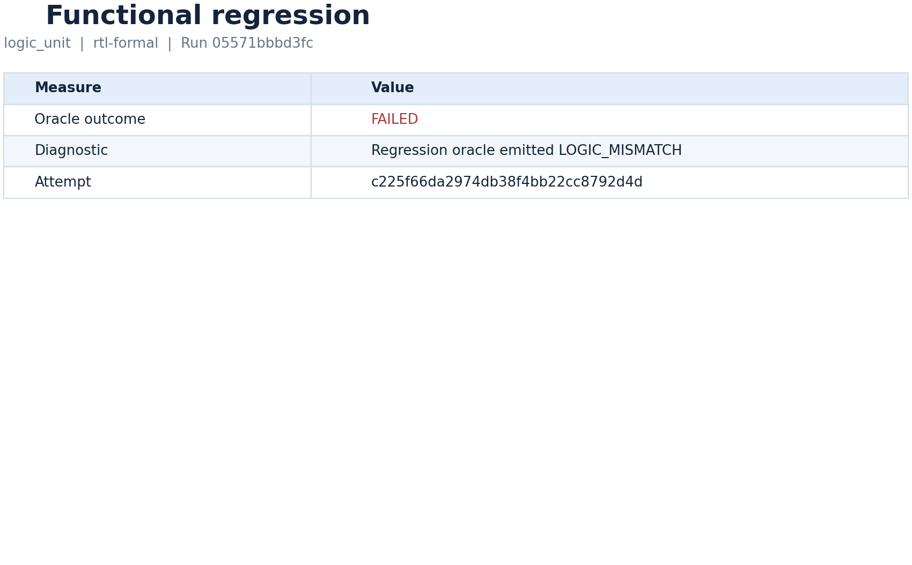

*Icarus and Yosys negative fixture. Functional regression, equivalence and acceptance failed. The subsequent XOR restoration passed both checks.* [Figure provenance](docs/images/examples/verification-regression/provenance.json)

A passing two-state combinational proof covers all defined binary input assignments at the matched boundary. Sequential state reachability, reset sequences, X/Z behavior and clock domain crossings (CDC) require separately defined proof models. Structural correspondence checks interfaces. Differential testing covers observations under the exercised stimulus. AES uses both forms of evidence with bounded native regressions.

## Complete physical flow

The source-resolution and functional lanes can run before implementation. The seven boxes in the ORFS lane are the executable controller stages. Configuration-specific substeps such as power planning, resizing and pin placement run inside those stages.

~~~mermaid
flowchart TD
    RTL["RTL, packages, includes and generated files"] --> Resolve["Ordered manifest or FuseSoC synthesis EDAM"]
    Resolve --> Elab["Yosys elaboration with optional sv2v"]
    Elab --> RTLCheck["Icarus oracle, Yosys SAT or scoped native regression"]
    Resolve --> Plan["Pinned ORFS manifest and stage plan"]
    Plan --> Admit["Resource admission for isolated retries"]
    Admit --> S1
    subgraph ORFS["Seven fixed controller stages"]
        S1["1 Synth · elaborate, optimize and technology map"] --> S2["2 Floorplan · die, core, rows, macros and power grid"]
        S2 --> S3["3 Place · pin placement, global placement and legalization"]
        S3 --> S4["4 CTS · clock buffers, sinks and timing"]
        S4 --> S5["5 GRT · guide rectangles, capacity and estimated RC"]
        S5 --> S6["6 Route · pin access, wires, vias and router DRC"]
        S6 --> S7["7 Finish · OpenRCX, OpenSTA, netlist and GDSII"]
    end
    S7 --> Checks["Independent coverage, KLayout reopen, DRC and LVS"]
    S1 -.-> Evidence["Attempt database, checkpoint hashes and native logs"]
    S4 -.-> Evidence
    S7 -.-> Evidence
    RTLCheck --> Evidence
    Checks --> Evidence
    Evidence --> Report["Qualification and reporting"]
    Evidence --> Studio["Studio and read-only MCP"]
    Evidence --> AI["Deterministic diagnosis and optional supervisor"]
    Report --> Opt["Bounded optimizer"]
    AI --> Review["Operator approval"]
    Opt --> Review
    Review --> Plan
~~~

The planner resolves the fixed stage dependencies and expected outputs. The controller checks prerequisites and starts bounded offline Docker processes. Per-stage and independent verification receipts bind metrics and decisions to source hashes. The optimizer uses those gates to judge feasibility. Studio and MCP consume evidence, and the model can select supported interpretations. The operator authorizes execution with explicit commands and, where required by the workflow, a plan digest.

~~~mermaid
flowchart LR
    Host["Python controller"] --> Docker["Pinned Linux amd64 Docker image"]
    Docker --> Make["ORFS Make targets"]
    Make --> Yosys["Yosys and ABC mapping"]
    Make --> OpenROAD["OpenROAD and OpenDB"]
    OpenROAD --> RCX["OpenRCX extraction"]
    OpenROAD --> STA["OpenSTA timing"]
    Make --> KLayout["KLayout stream-out and platform decks"]
    Docker --> Independent["Independent OpenSTA coverage and KLayout reopening"]
    Yosys --> Archive["Native logs, metrics and artifacts"]
    RCX --> Archive
    STA --> Archive
    KLayout --> Archive
    Independent --> Archive
~~~

### Reference design and output locations

The [GCD manifest](configs/gcd-sky130hd.toml) selects the pinned upstream `designs/sky130hd/gcd/config.mk` at `23341145f0fc92a522de26d5244a4a0013818f97`. The image supplies the authoritative Verilog file list, the Sky130HD standard-cell views and the original 1.1 ns constraints. The typical timing corner is `tt_025C_1v80`. The commands below preserve these inputs.

Each entry below uses the file basename under `results/sky130hd/gcd/base/`, `reports/sky130hd/gcd/base/` or `logs/sky130hd/gcd/base/` inside the run directory. The `name` in the stage heading is the exact key in `plan` and the stage attempt records. Use one `run` or `resume` command to dispatch the dependency chain.

### Stage 1 — synthesis

**Inputs and objective.** Yosys elaborates the configured top, optimizes logic, and maps it through the Sky130HD Liberty cells. ABC participates in technology mapping. The pinned timing and mapping settings affect the chosen cells. OpenROAD reads the mapped netlist and writes the first OpenDB (`.odb`) checkpoint with connectivity and an accompanying Synopsys Design Constraints (`.sdc`) file.

**Read the result.** Native `results/…/1_2_yosys.v` is the mapped netlist. The controller requires `1_synth.odb` and `1_synth.sdc`. Check `logs/…/1_2_yosys.log` and `1_synth.json` for library reads, missing cells and errors. The retained result has 222 standard cells and 2,313.47 µm² of mapped cell area. Die and core geometry begin in floorplanning.

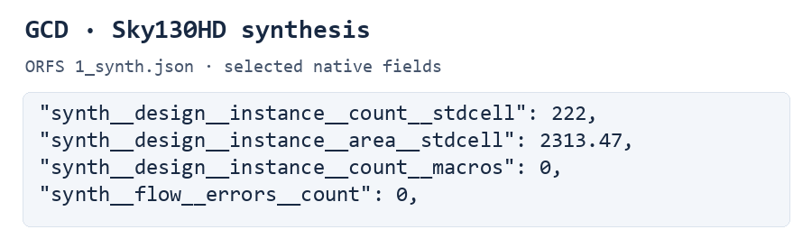

*GCD synthesis completed. This is a rendered excerpt of the native ORFS metrics from the unplaced synthesis database.* [Native metrics](docs/images/readme/gcd-synthesis.json) · [Render provenance](docs/images/readme/provenance.json)

**Diagnose.** Inspect the first Yosys error, the input design config and `synth_check.txt` where available. An unresolved top or package calls for source-list and hierarchy review. A mapping or link error calls for a check of the selected Liberty cell names, LEF abstracts and macro declarations.

### Stage 2 — floorplanning

**Inputs and objective.** OpenROAD loads the synthesis database and selects die and core bounds, site rows, tapcells and the power-distribution network. Core utilization measures cell area relative to core area. Aspect ratio, margins, power straps and macro halos affect capacity and pin access. Use the actual ORFS substep log when tracing pin placement between floorplan and placement. GCD contains zero macros.

**Read the result.** `2_floorplan.odb` and `2_floorplan.sdc` feed placement. `logs/…/2_1_floorplan.json` reports 6,404 µm² die area and 5,885.64 µm² core area. `reports/…/2_floorplan_final.rpt` carries timing observations. Inspect PDN and tapcell logs separately when those substeps fail.

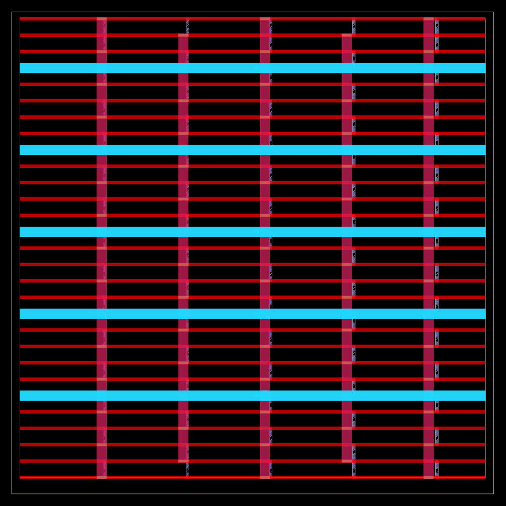

*GCD floorplan completed in OpenROAD. The checkpoint feeds placement.* [Snapshot source and hash](docs/images/gcd-stage-snapshots/provenance.json)

**Diagnose.** Check row and site availability, die/core containment, layer and via definitions, and the expected power nets and terminals. If a geometry or view change is needed, create a separate experiment with a reviewed configuration.

### Stage 3 — placement

**Inputs and objective.** OpenROAD places IO pins and standard cells using the floorplan, timing inputs and legal site geometry. Global placement distributes cells across the core. Detailed placement moves them onto legal sites and removes overlaps. Timing-driven resizing or buffering can increase effective utilization, and high density can reduce routing flexibility.

**Read the result.** `3_place.odb` and `3_place.sdc` feed CTS. Inspect `reports/…/3_global_place.rpt`, `3_detailed_place.rpt` and `logs/…/3_5_place_dp.json`. This GCD checkpoint recorded 502 cells, 3,980.07 µm² of cell area and 67.62% post-placement standard-cell utilization. Review displacement, overlaps and congestion in their native reports before attributing a timing change to density.

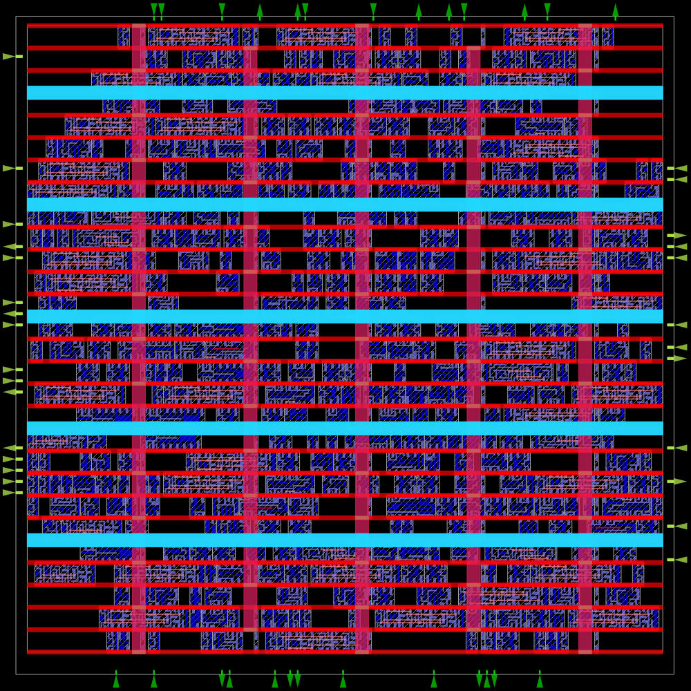

*GCD placement completed with 502 cells in the published OpenDB checkpoint.* [Snapshot provenance](docs/images/gcd-stage-snapshots/provenance.json) · [Stage metrics](docs/evidence/gcd-walkthrough/diagnosis.txt)

**Diagnose.** Check the first placement violation, available rows and blockages, then locate the involved instance or pin in Studio. Compare reported density and displacement with the configured limits. Isolate a utilization or floorplan change and re-evaluate timing and routing.

### Stage 4 — clock-tree synthesis

**Inputs and objective.** CTS reads the legal placement and clock definitions. OpenROAD builds a buffered network from clock roots to sinks. Insertion delay is the propagation time to a sink. Skew is the difference between relevant clock arrival times. With propagated clocks, changes to launch and capture arrival affect setup and hold in different directions.

**Read the result.** `4_cts.odb` and `4_cts.sdc` feed global route. Use `logs/…/4_1_cts.json` and `reports/…/4_cts_final.rpt` for clock and timing evidence. GCD shows 521 cells, six clock nets and 0.00387237 ns reported setup skew. Review the native sink inventory and clock reports for coverage and latency.

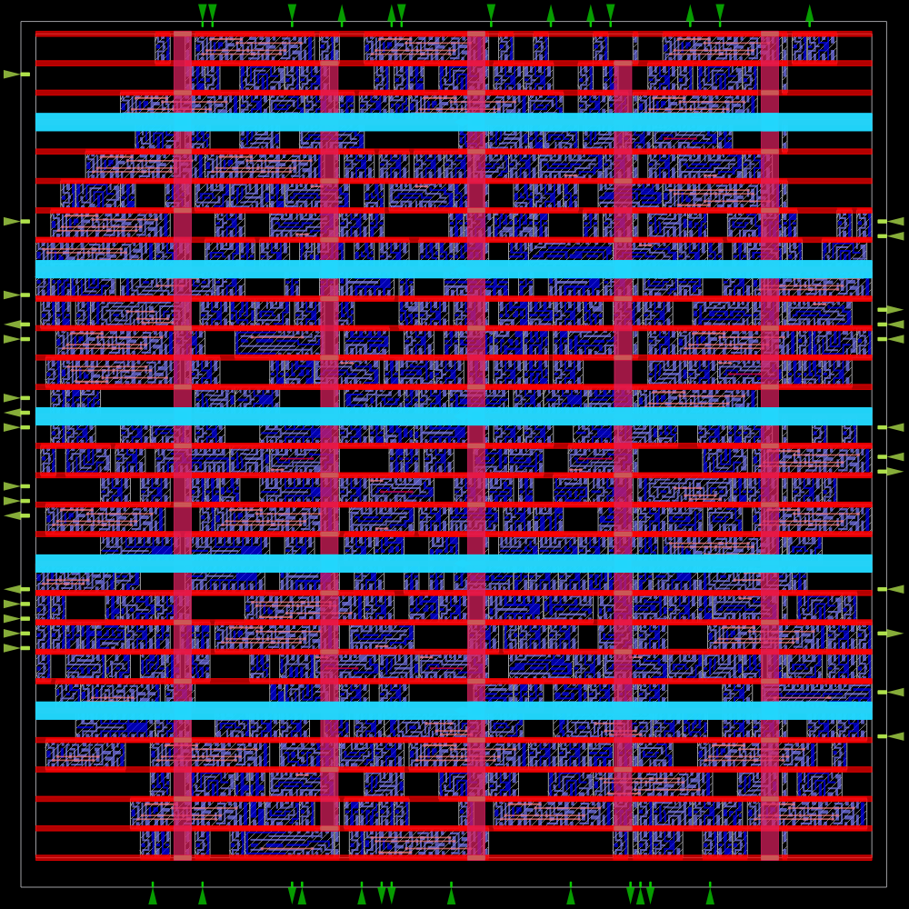

*GCD CTS completed. This checkpoint supplies the propagated clock network for later timing analysis.* [Snapshot provenance](docs/images/gcd-stage-snapshots/provenance.json) · [CTS observations](docs/evidence/gcd-walkthrough/diagnosis.txt)

**Diagnose.** Inspect the active clock definitions, then trace missing sinks, clock buffers and skew. Verify that launch and capture paths have the expected clock and propagation state. Layout geometry alone cannot establish sink coverage or slack.

### Stage 5 — global routing

**Inputs and objective.** OpenROAD allocates approximate paths over routing layers and grid cells. Each grid edge has capacity derived from tracks and constraints. Overflow identifies demand in excess of modeled capacity. The route guides inform detailed routing, and estimated resistance and capacitance (RC) support pre-route timing.

**Read the result.** `5_1_grt.odb` and `5_1_grt.sdc` feed detailed route. Check `logs/…/5_1_grt.log` and `5_1_grt.json`, and `reports/…/5_global_route.rpt`. GCD recorded zero total overflow, 11,854 µm on the initial global-route wirelength metric, and setup worst slack of −1.23073 ns. The exported checkpoint exposes 2,867 guide rectangles and 500 grid-cell records. Extracted detailed-wire parasitics can change the limiting path and its slack.

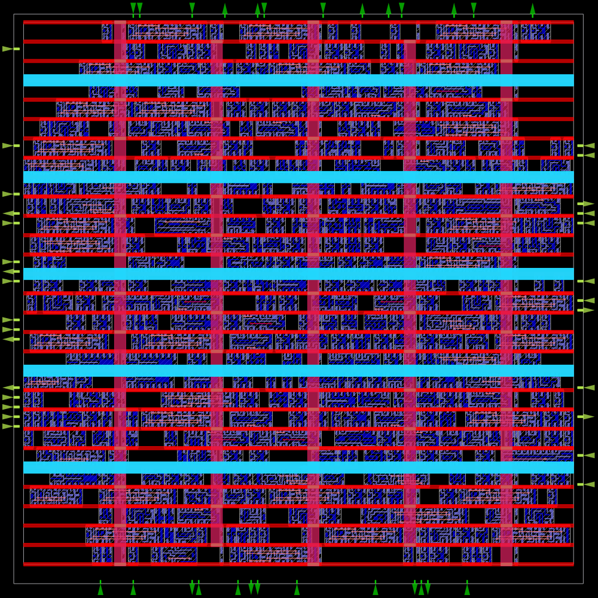

*GCD global routing completed with zero recorded overflow and failed estimated setup.* [OpenDB source](docs/images/gcd-stage-snapshots/provenance.json) · [Timing observations](docs/evidence/gcd-walkthrough/diagnosis.txt)

**Diagnose.** Read the per-layer overflow and repair trajectory, then inspect local grid usage and pin access. A zero aggregate overflow still leaves detailed spacing, via and access constraints to solve.

### Stage 6 — detailed routing

**Inputs and objective.** OpenROAD consumes the guides, technology and cell pin geometry. The router locates access points, assigns actual tracks, wires and vias, and iterates on geometric violations. Log progress, resource samples and the final report capture different points in that process.

**Read the result.** `5_route.odb` and `5_route.sdc` carry the routed checkpoint. Check `logs/…/5_2_route.json` and `reports/…/5_route_drc.rpt`. GCD's final router count is zero and wirelength is 7,425 µm. Intermediate violation counts were 119, 33 and 51 before reaching zero. Those iterations do not indicate final platform DRC.

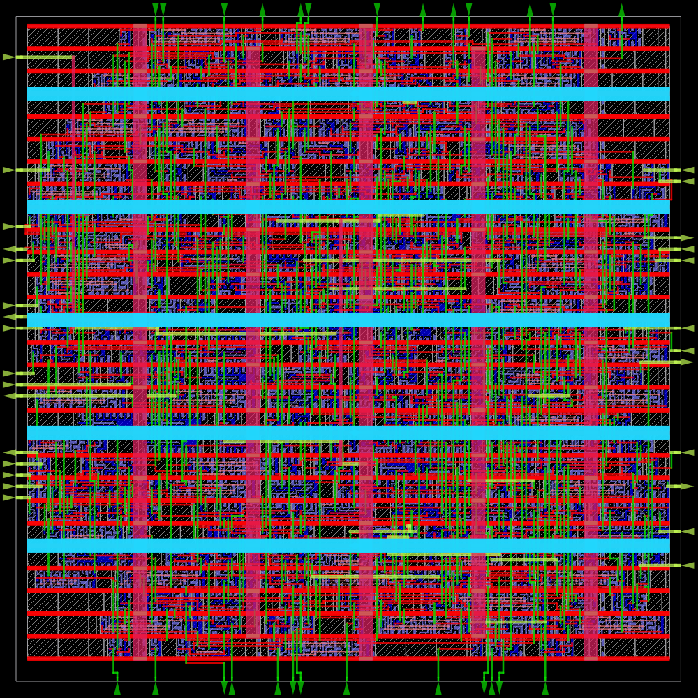

*GCD detailed route completed and the native router reported zero terminal violations.* [Snapshot provenance](docs/images/gcd-stage-snapshots/provenance.json) · [Attempt receipt](docs/evidence/gcd-walkthrough/receipt.json)

**Diagnose.** If detailed route terminates early, inspect its attempt log and resource receipt before readback of the routed checkpoint. AES left an incomplete iteration after timeouts and a separate confirmed OOM. Its intermediate 15,973 violations are a progress observation. A missing current routed checkpoint blocks finish and dependent gates.

### Stage 7 — finish, extraction and GDSII

**Inputs and objective.** ORFS loads the routed database and writes the final netlist and constraints. OpenRCX models the routed wire and via resistance and capacitance through parasitic extraction (PEX) and writes Standard Parasitic Exchange Format (SPEF). OpenSTA uses extracted data and the configured Liberty corner. KLayout merges geometry for GDSII stream-out. A separate KLayout process reopens the final GDS.

**Read the result.** The controller checks `6_final.odb`, `6_final.v`, `6_final.sdc`, `6_final.spef` and `6_final.gds`. Use `logs/…/6_report.json`, `6_report.log` and `reports/…/6_finish.rpt` for metrics and timing paths. The published GCD result has 524 standard cells, 4,414.23 µm² standard-cell area, final worst setup slack −1.20488 ns and worst hold slack +0.429847 ns. The independent GDS view exposed 56,243 polygons.

*GCD finish completed in OpenROAD. The final routed database and the independently reopened [GDSII shown above](#visual-introduction) are separate artifacts.* [Finish and GDS sources](docs/images/gcd-stage-snapshots/provenance.json) · [Native metrics](docs/evidence/gcd-walkthrough/6_report.json)

**Diagnose.** Check for extractor activity, matching SDC and SPEF and parsed endpoint coverage. Use the final STA report for timing failures. Check the layer map and cell GDS inventory when stream-out or reopening fails. If any final artifact is missing or superseded, inspect the last valid attempt before reporting a gate status.

| Format | Role in this flow |
| --- | --- |
| `.v`, `.sv` | RTL input. `1_2_yosys.v` and `6_final.v` are mapped and final netlists, respectively. |
| `.odb` | OpenDB database holding stage-specific logical and physical state |
| `.sdc` | Clocks, port timing and exceptions used by the applicable analysis |
| `.spef` | Extracted parasitics for final STA |
| `.def`, `.lef` | Design Exchange Format placement/routing exchange and Library Exchange Format physical abstracts. Studio can export a standalone DEF preview using ordered technology and cell LEFs. |
| `.lib` | Liberty cell logic, timing, electrical and area model for the selected corner |
| `.gds` | Hierarchical process-layer layout geometry |
| `.rpt`, `.log`, `.json` | Native text reports, execution logs, metrics and controller receipts |

## Run and inspect GCD

After the Linux or WSL2 [installation](#installation-and-quickstart), run the following from the same repository root. The target directories must be new. The verification command is expected to return 1 at the original clock. The example allows that outcome and stops on unexpected verification errors. Run this block in Bash.

~~~sh
mkdir -p experiments
run=experiments/gcd-walkthrough
snapshots=experiments/gcd-snapshots

autonomous-eda doctor --engine docker
autonomous-eda plan configs/gcd-sky130hd.toml
autonomous-eda run configs/gcd-sky130hd.toml "$run" --memory-mib 1200

verify_exit=0
autonomous-eda verify "$run" --profile physical --coverage --decks --markdown ||
  verify_exit=$?
test "$verify_exit" -le 1 || exit "$verify_exit"

autonomous-eda report "$run" --profile physical --markdown
autonomous-eda report "$run" --engineering
autonomous-eda diagnose "$run" --check setup
autonomous-eda artifacts render "$run" --layout
autonomous-eda artifacts gallery "$run"
autonomous-eda artifacts snapshots "$run" "$snapshots"
autonomous-eda resume "$run"
autonomous-eda resources history "$run" --limit 16 --samples 2
autonomous-eda readiness qualification "$run"
autonomous-eda artifacts workspace "$snapshots" --run "$run"
~~~

Open the printed loopback URL in a browser. With the default port, use `http://127.0.0.1:8765/`. Stop the server with Ctrl+C. `--port` can select another local port. Exported layout PNGs and their manifest are under `$run/visualizations/`. The snapshot bundle stores independent stage PNGs, inspectable geometry, source hashes and per-stage statuses. Resume provides the same attempts when the underlying fingerprints and checkpoints still match. Legacy receipts may return no resource samples.

The recorded walkthrough completed seven stages in 145.208 s of stage time. The original run and its resume produced identical JSON. The plan begins with the synthesis checkpoint. The retained physical verification reported the following. [Run and resume receipt](docs/evidence/gcd-walkthrough/receipt.json) · [Complete plan](docs/evidence/gcd-walkthrough/plan.json)

~~~json
{
  "name": "synth",
  "after": [],
  "outputs": [
    "results/sky130hd/gcd/base/1_synth.odb",
    "results/sky130hd/gcd/base/1_synth.sdc"
  ]
}
~~~

~~~text
- Implementation completion **PASSED**
- Verification **FAILED**
- Physical feasibility **FAILED**
- Optimization objectives **NOT_APPLICABLE**
- Full acceptance **FAILED**
~~~

Successful native commands and seven validated stages establish implementation completion. Required evidence gates independently evaluate timing, physical checks and full acceptance. In this run, the extracted setup gate fails even though the layout and decks completed. [Captured verification output](docs/evidence/gcd-walkthrough/verification.txt)

## Static timing analysis

STA computes paths through timing arcs and nets without simulating input vectors. For a register-to-register setup check, a launch register sends data after its active clock edge. The data path includes clock-to-Q, combinational cell and net delays. A capture register needs stable data before a later capture edge by its setup requirement. Setup slack is **required time minus late data arrival time**. A hold check tests the early arrival against the minimum stability window around the active edge. Hold slack is **early arrival time minus the minimum required time**.

The SDC selects periods, waveforms, uncertainty and propagation, input and output min/max delays, and reviewed exceptions. The period is the nominal edge spacing. Clock insertion and skew, setup/hold cell checks and uncertainty contribute to the required time. Input/output delays express the external launch, capture and board/interface budget. A missing timed endpoint, reset exception or omitted port budget can make favorable slack meaningless for the excluded path. Check coverage in the final corner and cross-check with the integration constraints.

### Read a captured OpenSTA path

~~~sh
run=experiments/gcd-walkthrough
autonomous-eda diagnose "$run" --check setup
autonomous-eda diagnose "$run" --check hold --json
sed -n '132,205p' "$run/reports/sky130hd/gcd/base/6_finish.rpt"
~~~

The line range is from the published run. Use the diagnostic citation to find the applicable range if a fresh tool invocation emits a different report.

~~~text
finish 96cb89b29896595c43b8 dpath.b_reg.out[2]$_DFFE_PP_ -> dpath.a_reg.out[10]$_DFFE_PP_
  register-to-register / core_clock | arrival 2.35 ns | required 1.14 ns | slack -1.2 ns
  reports/sky130hd/gcd/base/6_finish.rpt:132-205
~~~

Follow the report from launch clock to output pin, through the data increments and into the capture requirement. The reported data delay is 2.06 ns, and rounded launch and capture latencies are 0.29 and 0.28 ns. Use the native JSON for the higher-precision worst setup slack of **−1.20488 ns**. The limiting endpoint missed its setup requirement by about 1.205 ns at the original 1.1 ns clock. Worst negative slack (WNS) is the most negative slack, or zero when there are no violations. Total negative slack (TNS) sums the tool-reported negative endpoint slacks. GCD setup TNS is −54.4492 ns with 68 setup violations, while hold TNS is zero. [Path and delay accounting](docs/evidence/gcd-walkthrough/diagnosis.txt) · [Final metrics](docs/evidence/gcd-walkthrough/6_report.json)

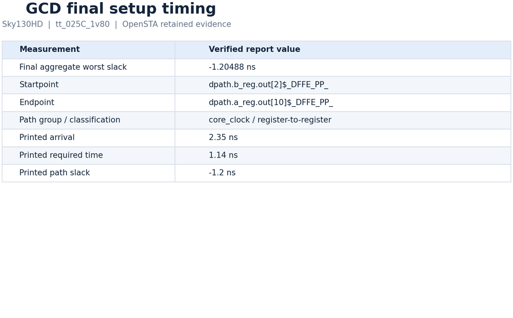

*Retained GCD at 1.1 ns. Stage timing is a pre-route estimate until extracted finish timing. The final setup observation fails.* [Figure provenance](docs/images/examples/gcd/provenance.json)

Review whether the same endpoints and corner are present across checkpoint reports before using a slack delta to explain a change. Inspect the highest-delay arcs, driving slew, loads, routed RC and skew. The published report's rounded net-delay accounting leaves uncertainty. Investigate utilization, legal sizing and buffering, placement and congestion using isolated experiments. If the specification permits a different clock or change to the timing budget, record that as a new constraint baseline and evaluate all gates again.

## Physical verification and acceptance

The planner's final product assertions and the verification evaluator ask different engineering questions.

1. **Implementation completion** checks the ordered stages and current outputs, including OpenDB, SDC, SPEF, mapped netlist and GDSII.
2. **Router DRC** checks the detailed router's terminal report. **Platform DRC** applies the technology layout deck to the stream-out. **LVS** extracts and compares electrical connectivity against the recorded reference netlist.
3. **Independent GDSII reopening** reads the actual streamed file in a separate KLayout process, checks expected top-level structure and records the hash. It establishes that the stream is readable and structurally consistent for the configured probe.
4. **Extracted STA and coverage** evaluate min/max timing, clocks and timed endpoints using the final checkpoint, matching constraints, SPEF and timing library.
5. **Acceptance and qualification** apply gate requirements over verified receipts. The `full` profile additionally requires configured RTL and connectivity evidence. The independent qualification reader also tracks extraction and design/interface readiness.

~~~sh
run=experiments/gcd-walkthrough
autonomous-eda verify "$run" --profile physical --coverage --decks --markdown
autonomous-eda report "$run" --profile full --markdown
autonomous-eda report "$run" --artifact results/sky130hd/gcd/base/6_final.gds
autonomous-eda readiness qualification "$run"
~~~

Use `verify RUN` without a profile for independent platform decks alone. With `--profile physical --coverage --decks` the independent coverage probe consumes the hash-backed final ODB/SDC/SPEF and the deck targets are reapplied. The run stores each invocation's command, logs and receipts. Reopening runs during finish. Use `artifacts render --layout` to read the GDSII independently for presentation. It does not stand in for the recorded reopen and deck gates. [GCD captured verification](docs/evidence/gcd-walkthrough/verification.txt) · [Independent GCD qualification](docs/evidence/resource-telemetry/gcd-qualification.json)

| Gate state | Meaning |
| --- | --- |
| `PASSED` | Verified evidence satisfies the check. |
| `FAILED` | Evidence establishes a violation or mismatch. |
| `BLOCKED` | Required evidence, collateral or execution is unavailable or invalid. |
| `UNKNOWN` | The available evidence does not establish an outcome. |
| `NOT_APPLICABLE` | A supported applicability rule excludes the gate. |

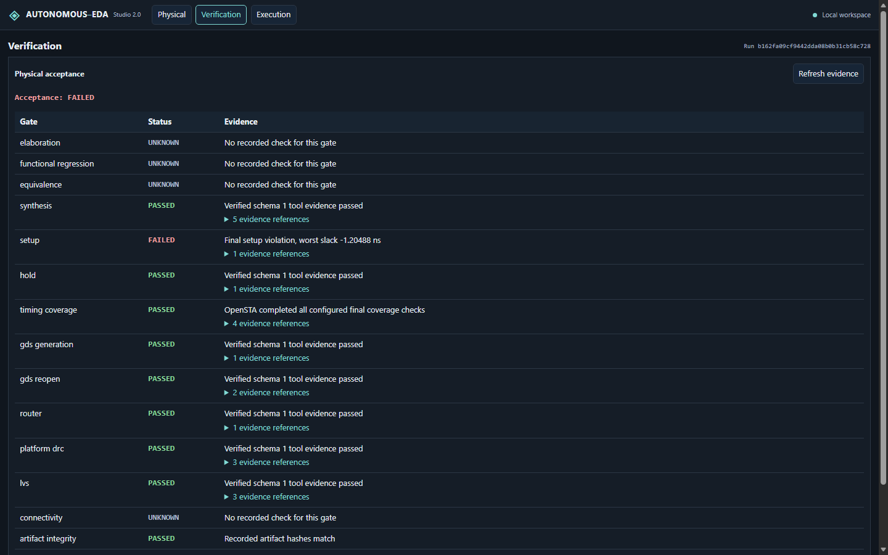

*GCD core verification in Studio. Setup failed. Hold, router, platform DRC, LVS and reopening passed in the retained physical run.* [Browser provenance](docs/images/studio/provenance.json) · [Gate record](docs/evidence/gcd-walkthrough/verification.txt)

Core gates qualify the supplied design boundary and its platform. Full-chip acceptance also needs documented pad modes, verified supply-domain connectivity, hierarchical timing and physical decks, consistent pad and macro GDS, LEF and Liberty views, plus the applicable electrical and package checks. The ICeWall case study below records an explicit power failure and blocked full-chip gates.

## OpenTitan AES

The intermediate design is the masked `aes` peripheral from OpenTitan Earl Grey 1.0.0, revision `b2d662157db2802bde0e40dfc96fd0316042d116`. It exercises generated primitives, package order, an integrated register interface, EDN entropy and multiple clock/reset domains. The pinned export resolved 226 sources and 11 generated primitives. Yosys observed 174 reachable modules and 2,172 hierarchical instances. Generic synthesis counted 56,622 primitive cells and ORFS technology mapping produced 60,206 Sky130HD standard cells occupying 487,449 µm². These stages count different objects. [Source resolution](docs/evidence/opentitan-aes/resolved.json) · [Native inventory](docs/evidence/opentitan-aes/inspect.json) · [Physical pilot](docs/evidence/opentitan-aes/physical.json)

### Reproduce the pinned fileset

Use the Linux environment, the sv2v v0.0.13 binary and Yosys `0.68+post` from the pinned ORFS build on the tool path for the inspection step. The measured sv2v archive SHA-256 is `552799a1d76cd177b9b4cc63a3e77823a3d2a6eb4ef28e1ff8`. Verify the downloaded archive with `sha256sum`. Use a Linux filesystem for the upstream clone and Python 3.12 for the pinned FuseSoC environment. [sv2v release](https://github.com/zachjs/sv2v/releases/tag/v0.0.13) · [Pinned export recipe](docs/tutorials/OPENTITAN_AES.md#reproduce-the-ordered-manifest)

~~~sh
work=$(mktemp -d)
revision=b2d662157db2802bde0e40dfc96fd0316042d116
git clone --branch earlgrey_1.0.0 --single-branch --depth 1 \
  https://github.com/lowRISC/opentitan.git "$work/earlgrey"
git -C "$work/earlgrey" checkout --detach "$revision"
python3.12 -m venv "$work/tools"
"$work/tools/bin/python" -m pip install \
  'fusesoc @ https://github.com/lowRISC/fusesoc/archive/refs/tags/ot-0.5.dev0.zip' \
  'edalize @ https://github.com/lowRISC/edalize/archive/refs/tags/v0.4.0.zip' \
  mako==1.1.6 Jinja2==3.1.6 MarkupSafe==3.0.4 attrs==26.1.0 okonomiyaki==3.0.0 \
  pyparsing==3.3.3 pyyaml==6.0.3 simplesat==0.9.2 six==1.17.0
for attempt in first second; do
  out="$work/$attempt"
  (cd "$work/earlgrey" && PATH="$work/tools/bin:$PATH" PYTHONHASHSEED=0 \
    fusesoc --cores-root=. run --target=syn --tool=icarus --setup \
    --build-root="$out" lowrisc:ip:aes)
  edam="$out/syn-icarus/lowrisc_ip_aes_1.0.eda"
  "$work/tools/bin/python" -c 'import json,sys,yaml; json.dump(yaml.safe_load(sys.stdin),sys.stdout,indent=2)' \
    <"$edam.yml" >"$edam.json"
  autonomous-eda ingest "$edam.json" "$out/design.toml" --revision "$revision" \
    --generated-core-prefix lowrisc:prim_abstract: >"$out/resolved.json"
done
cmp "$work/first/resolved.json" "$work/second/resolved.json"
autonomous-eda inspect "$work/first/design.toml" --timeout 180 \
  --netlist "$work/aes-netlist.json" --translated-verilog "$work/aes-translated.v" \
  >"$work/aes-inspect.json"
~~~

The unseeded generator reordered an enum in `prim_pkg.sv`. The two seeded builds matched the resolved input and manifest hashes. Compare the translated output hash to the repository receipt before attempting physical use. The pinned AES adapter accepts the recorded translation digest and stages its pinned Make configuration and block SDC. The experiment uses a common ideal 8.5 ns clock definition over `clk_i` and `clk_edn_i`, separate nets, 35% starting utilization and two cores. The production integration metadata and block timing contract have further obligations. [Generated inputs and exact output hashes](docs/evidence/opentitan-aes/receipt.json) · [Physical manifest](configs/opentitan-aes-sky130hd.toml)

To dispatch the isolated physical pilot with the reproduced translation, use a finite budget and a fresh target. The original trial's detailed route timed out.

~~~sh
autonomous-eda run configs/opentitan-aes-sky130hd.toml experiments/aes-physical \
  --translated-rtl "$work/aes-translated.v" --memory-mib 3000 \
  --wall-clock-seconds 1800 --max-artifact-mib 4096
autonomous-eda report experiments/aes-physical --engineering
autonomous-eda resources history experiments/aes-physical --samples 2
autonomous-eda readiness qualification experiments/aes-physical
~~~

### Functional and interface qualification

| Check | Milestone 12 observation |
| --- | --- |
| Upstream cipher-core regression | Verilator 5.020 completed 3,297 cycles, successful masked encrypt/decrypt round-trip markers and exit 0. |
| Independent peripheral test | AES-128 ECB encrypt/decrypt from the FIPS 197 vector. The harness exercised TL-UL transactions, shadowed writes, output consumption, reset, invalid address and deterministic EDN handshakes. |
| Interface correspondence | All 14 top ports matched in direction and width. There are two clock inputs and three resets, with TL-UL, key manager, EDN, alert, escalation and idle interfaces. |
| Differential test | The original SystemVerilog and the Yosys-elaborated model of the exact sv2v translation matched 626 observed cycles. Verilator's direct read of raw sv2v output encountered a zero-width part-select limitation. |
| Sequential equivalence | **BLOCKED**. The test shares a clock schedule, holds sideload inactive, and uses two-state simulation. A proof requires qualified elaboration and explicit reset, CDC, entropy and X/Z semantics. |
| Pre-route timing contract | OpenSTA read the mapped synthesis checkpoint and one `main` clock. Endpoint and I/O delay coverage failed. Clock relationships, uncertainty, port delays and loads, shadow reset, CDC and exception review remain open. |

[Milestone 12 receipts and reproduction](docs/MILESTONE_12_EVALUATION.md) · [Interface contract](docs/evidence/opentitan-aes/qualification/contract.json) · [Peripheral correspondence](docs/evidence/opentitan-aes/qualification/peripheral.json)

For native qualification, use the same generated synthesis tree, a retained physical run with the matching inputs and a fresh output directory. The pinned command requires Verilator 5.020, Make and, for peripheral checks, the pinned Yosys frontend. Prepare the DV elaboration and normalize the upstream TopGen HJSON. [Native tool preparation](docs/tutorials/OPENTITAN_AES.md#run-the-upstream-cipher-core-testbench)

~~~sh
run=experiments/aes-physical
published=docs/evidence/opentitan-aes
source_manifest="$work/first/design.toml"
edam="$work/first/syn-icarus/lowrisc_ip_aes_1.0.eda.json"
mkdir "$work/qualification"
"$work/tools/bin/python" -m pip install hjson==3.1.0
"$work/tools/bin/python" -c 'import hjson,json,sys; json.dump(hjson.load(sys.stdin),sys.stdout,indent=2)' \
  <"$work/earlgrey/hw/top_earlgrey/data/top_earlgrey.hjson" >"$work/topgen.json"
(cd "$work/earlgrey" && PATH="$work/tools/bin:$PATH" PYTHONHASHSEED=0 \
  fusesoc --cores-root=. run --setup --build-root="$work/aes-dv" \
  lowrisc:dv_verilator:aes_cipher_core_tb)

autonomous-eda readiness aes-contract "$run" \
  --source-manifest "$source_manifest" --edam "$edam" --resolved "$published/resolved.json" \
  --inspection "$published/inspect.json" --topgen "$work/topgen.json" --upstream "$work/earlgrey" \
  --native-output "$work/qualification/sta" >"$work/qualification/contract.json"
autonomous-eda readiness aes-core "$work/aes-dv/default-verilator" --timeout 270 \
  >"$work/qualification/cipher-core.json"
autonomous-eda readiness aes-peripheral "$run" \
  --source-manifest "$source_manifest" --edam "$edam" --resolved "$published/resolved.json" \
  --inspection "$published/inspect.json" --testbench examples/opentitan-aes/peripheral_tb.sv \
  --timeout 270 --output "$work/qualification/peripheral" >"$work/qualification/peripheral.json"
autonomous-eda readiness aes-record "$run" --contract "$work/qualification/contract.json" \
  --core "$work/qualification/cipher-core.json" --peripheral "$work/qualification/peripheral.json" \
  >"$work/qualification/aes-qualification.json"
~~~

Place the bound summary at `verification/aes-qualification.json` inside an approved copy of the matching physical run for qualification, Studio Resources and MCP readback. The controller checks the recorded identity. The compact receipts in Git can be read on their own. [Bound qualification receipt](docs/evidence/opentitan-aes/qualification/aes-qualification.json)

### Milestone 12B interface closure evidence

The released 12B receipts bind TopGen and generated Earl Grey integration RTL to the native EDAM, pinned translation, mapped database and Liberty. The generated block connects both clock inputs to the same `clk_main_aes` net. Primary and EDN resets share `rst_lc_n[Domain0Sel]`. The shadow reset has its own `rst_lc_shadowed_n[Domain0Sel]` connection. TopGen identifies a nominal 100 MHz source. The isolated 8.5 ns probe retains its ideal clock and experimental timing scope.

| Native OpenSTA pre-route probe | Unconstrained endpoints | Uncovered inputs / outputs | Setup / hold worst slack (ns) |
| --- | ---: | ---: | ---: |
| Pinned clock-only SDC | 80 | 671 / 68 | −0.379158 / +0.331210 |
| Diagnostic TL-UL min/max delays and separate setup/hold uncertainty | 21 | 562 / 9 | −1.931299 / +0.231210 |

The diagnostic numbers are isolated trial inputs. Production peer budgets, slew and load, reset release and recovery/removal, exception qualification and CDC timing remain unresolved. The clock/reset review identified the two-flop EDN request/acknowledge synchronizers and the bundled entropy return. It leaves bundled data/skew, reconvergence and reset analysis for signoff. [Clock-only receipt](docs/evidence/opentitan-aes/m12b/contract.json) · [Diagnostic receipt](docs/evidence/opentitan-aes/m12b/diagnostic-contract.json)

The seed-41 harness ran common, phase-offset and independent clock schedules, sideload with active reset, and alerts/errors. Both models passed AES known answers, scoped TL-UL and EDN handshakes, and the tested sideload and error cases. All 14 ports still matched. The trace comparison covered 11,414 sampled edges across 6,488 core and 4,926 EDN edges. Separately, Yosys proved depth-eight correspondence for the 8-bit IV and 16-bit key `aes_reg_status` instances under shared abstract clock steps, an initial reset and binary inputs. The masked cipher state, other domains, entropy and X/Z semantics remain outside that bounded proof. [Native scenario and partition-proof evidence](docs/evidence/opentitan-aes/m12b/peripheral.json)

Use a fresh output for the diagnostic STA and the multi-clock regression. The following extends the base reproduction above using the same `run`, `work` and published input receipts.

~~~sh
cat > "$work/qualification/budget.json" <<'JSON'
{
  "inputs": {"tl_i": {"min": 0.25, "max": 1.5}},
  "outputs": {"tl_o": {"min": 0.25, "max": 1.5}},
  "uncertainty_ns": {"setup": 0.25, "hold": 0.10}
}
JSON
autonomous-eda readiness aes-contract "$run" \
  --source-manifest "$source_manifest" --edam "$edam" --resolved "$published/resolved.json" \
  --inspection "$published/inspect.json" --topgen "$work/topgen.json" --upstream "$work/earlgrey" \
  --native-output "$work/qualification/diagnostic-sta" \
  --diagnostic-budget "$work/qualification/budget.json" --timeout 90 \
  >"$work/qualification/diagnostic-contract.json"
autonomous-eda readiness aes-peripheral "$run" \
  --source-manifest "$source_manifest" --edam "$edam" --resolved "$published/resolved.json" \
  --inspection "$published/inspect.json" --testbench examples/opentitan-aes/peripheral_tb.sv \
  --multi-clock --seed 41 --timeout 270 --output "$work/qualification/multi-clock" \
  >"$work/qualification/multi-clock.json"
autonomous-eda readiness aes-record "$run" --contract "$work/qualification/contract.json" \
  --core "$work/qualification/cipher-core.json" --peripheral "$work/qualification/multi-clock.json" \
  >"$work/qualification/aes-qualification-12b.json"
~~~

Bind the resulting summary under `verification/aes-qualification.json` in a copy of the same physical run to see scenario statuses in `readiness qualification`, Studio Resources and MCP `get_aes_qualification`. The published summary includes the documented resource preflight as well. [12B evaluation](docs/MILESTONE_12B_EVALUATION.md) · [Bound summary](docs/evidence/opentitan-aes/m12b/aes-qualification.json) · [CLI, MCP and Studio readback](docs/evidence/opentitan-aes/m12b/readback.json)

### Placement, routing attempts and admission

*OpenTitan AES physical pilot, verified OpenROAD `3_place.odb`. Placement, CTS and global route completed. Detailed route failed to complete.* [Checkpoint and renderer hashes](docs/images/examples/opentitan-aes/provenance.json) · [Pilot evidence](docs/evidence/opentitan-aes/physical.json)

Detailed placement reported 550,759 µm² cell area at about 40% utilization. CTS reported 770 clock buffers across the two input clocks and 1.10392 ns setup skew. Global route reported zero overflow and 4,446,663 µm estimated wirelength in its initial metric. Its final estimate gave +0.0053717 ns setup and +0.344325 ns hold. Extracted timing would require a completed detailed route.

| Attempt | Limit (s) | Elapsed (s) | Peak cgroup memory (B) | Terminal result |
| --- | ---: | ---: | ---: | --- |
| Original physical pilot | 900 | 900.839 | Unknown | Controller timeout, exit 124 |
| 3,000 MiB retry | 2,700 | 2,255.853 | 3,145,728,000 | `CONFIRMED_OOM`, Docker `OOMKilled=true`, recorded exit 2 |
| Separate 3,000 MiB bounded trial | 1,000 | 1,001.181 | 3,091,898,368 | `WALL_TIMEOUT`, controller exit 124, Docker exit 137 after SIGKILL, `OOMKilled=false` |
| 3,240 MiB exploratory proposal | 2,700 | — | — | Admission refused before launch. Milestone 12 measured at most 3,085 MiB. A separate 12B preflight measured 3,122 MiB under the same 8% reserve. |

[Original pilot](docs/evidence/opentitan-aes/physical.json) · [OOM](docs/evidence/resource-telemetry/aes-terminal.json) · [Separate bounded trial](docs/evidence/opentitan-aes/bounded-route.json) · [Milestone 12 admission](docs/evidence/opentitan-aes/qualification/resources.json) · [12B admission](docs/evidence/opentitan-aes/m12b/resources.json)

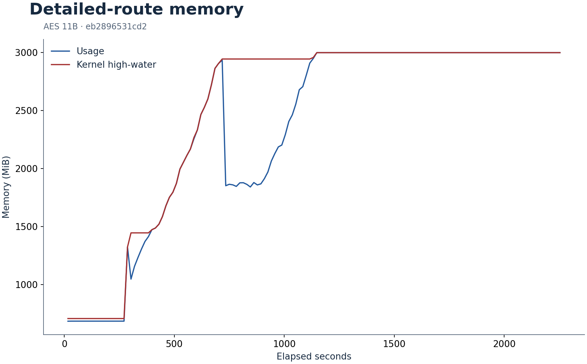

*Milestone 11 benchmark, finite route attempts on the pinned Sky130HD flow. The confirmed AES OOM reached the 3,000 MiB cap. Unmeasured peaks remain unavailable.* [Benchmark rows](docs/evidence/milestone-11-benchmark/report.json) · [PNG provenance](docs/evidence/milestone-11-benchmark/visualizations/visualization_manifest.json)

**Readiness remains Level 2.** The incomplete attempts have neither final extraction nor routed GDSII. Level 3 requires completed implementation, bound final artifacts and extraction, independent reopening, DRC and LVS, and evaluated extracted setup, hold and coverage. Level 4 additionally requires accepted core timing and physical gates, a qualified interface timing contract, full peripheral DV and translated-RTL equivalence. A larger budget can permit a trial, with completion still dependent on the router and observed evidence.

## Physical Design Studio

Export a bundle from an experiment and start the loopback viewer. The [GCD walkthrough](#run-and-inspect-gcd) creates both inputs. Exports use the pinned tools on Linux or WSL2. The viewer can serve an already exported bundle with base Python on Linux or Windows.

~~~sh
autonomous-eda artifacts workspace experiments/gcd-snapshots \
  --run experiments/gcd-walkthrough --port 8765
~~~

A bundle opens a specific run. Switch designs by exporting and opening the other run's bundle. The `--run` option attaches current verification and execution evidence. `--journal` attaches an AI observation journal. A screenshot can show the older snapshot stage even when a newer run attempt exists, so use the displayed source and attempt identity when citing evidence.

1. **Layout.** Select a stage from the stage selector. Scroll to zoom and drag to pan. Fit the layout to return to the full view. Toggle layers or overlays for pin locations, pads, clock topology, route guides, grid usage or routed wires. Tool-specific geometry limits affect which overlays are available.
2. **Object inspection.** Search for a cell or click a visible instance. Inspect its master, location and logical nets. Use **Measure** and two layout points to read a distance in µm. OpenDB supports object geometry. GDS carries polygon hierarchy. The vector wire overlay excludes some via and special-wire detail.
3. **Compare.** Select a second stage to compare placement and CTS or routing. The synchronized views shown in the introduction let you inspect the same region at two checkpoints.
4. **Timing paths.** Select setup or hold in **Timing paths**, read endpoints, clock, slack and source lines, then choose **Zoom to pins** when at least two anchors match. The overlay breaks at unresolved pins and reflects the printed report path.
5. **Verification.** Read the independent gates, their status and evidence. When the attached run lacks profiled verification, Studio exposes the available controller gates and indicates that the profile has not been checked.
6. **Execution and diagnostics.** Inspect recorded controller and supervisor events, tool version checks and verification receipts. Expand an attempt for its bounded log, exit and native classifier. The console polls recorded activity while visible. Execute stages from the CLI.
7. **Resources.** Choose an attempt to read its wall time, allocations, cgroup peak, sampled usage, terminal classification and recovery details. Live samples are provisional until terminal evidence binds them. Missing telemetry remains unknown. For AES, finish and downstream checks remain blocked.
8. **Export.** Save the canvas PNG and inspect the embedded source provenance. For a native renderer PNG use the stage bundle export and its `snapshots.json`. Cite the stage, run, checkpoint hash and renderer command together.

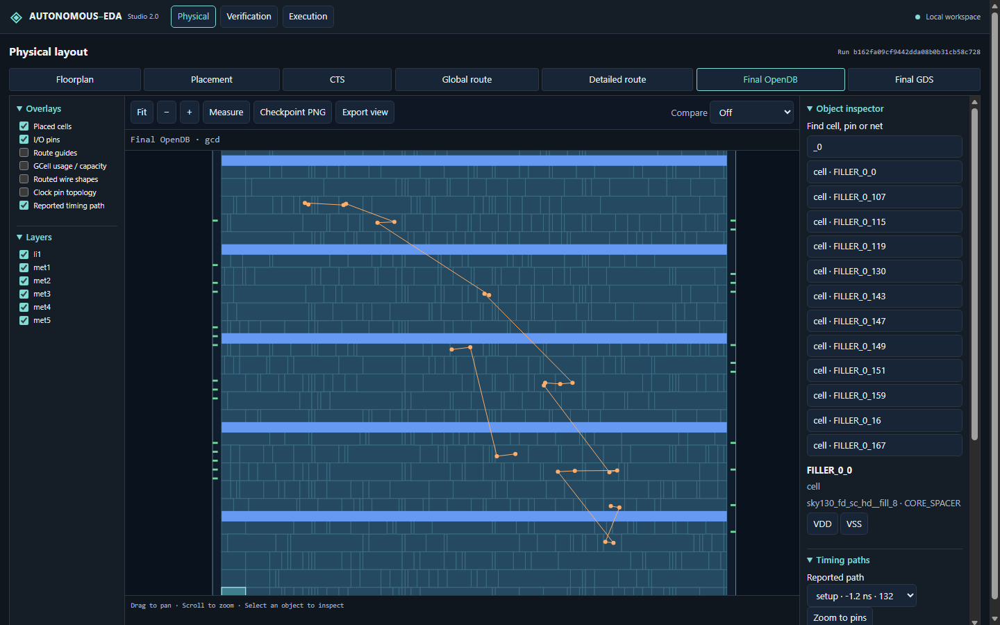

*GCD finish checkpoint, Studio object inspection. The selected instance is tied to the verified OpenDB.* [Capture source](docs/images/studio/provenance.json)

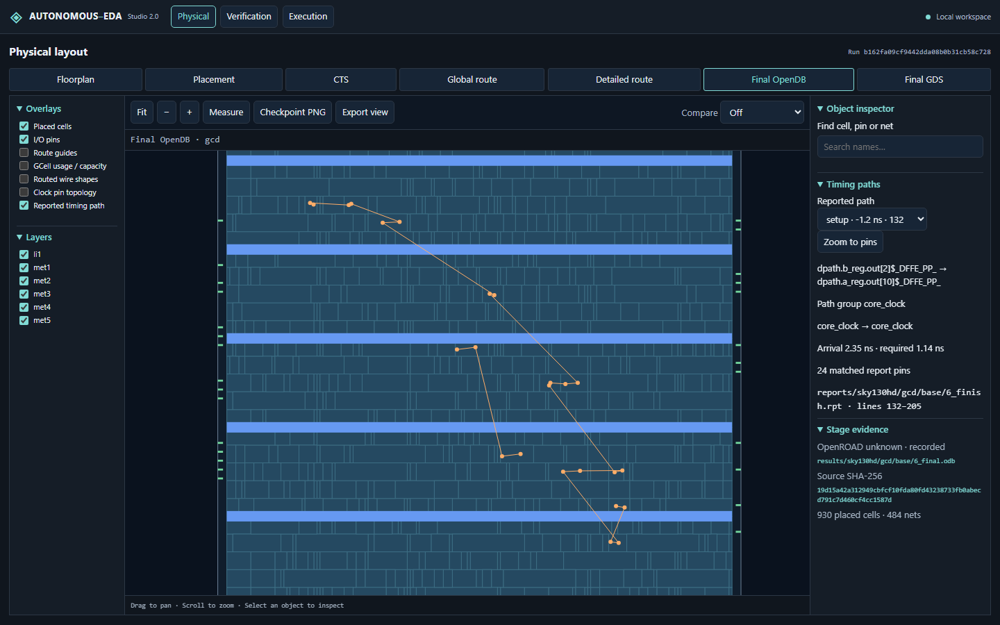

*GCD finish, selected violated setup path. Pin anchors are projected from the native timing report onto the recorded layout.* [Capture source](docs/images/studio/provenance.json)

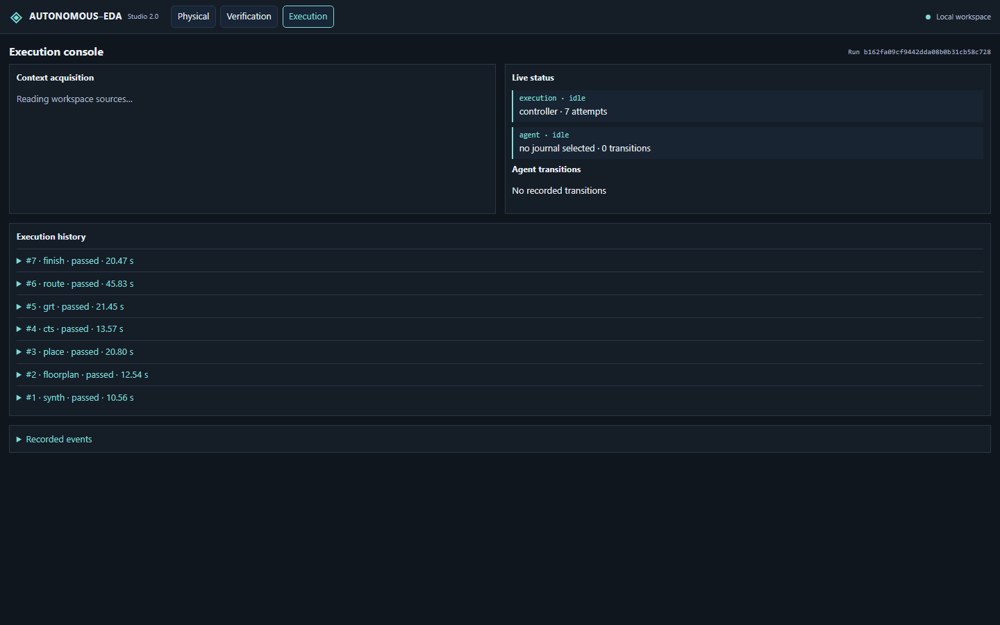

*GCD controller execution, captured from recorded attempts. The implementation completed, and setup failed independently.* [Capture source](docs/images/studio/provenance.json)

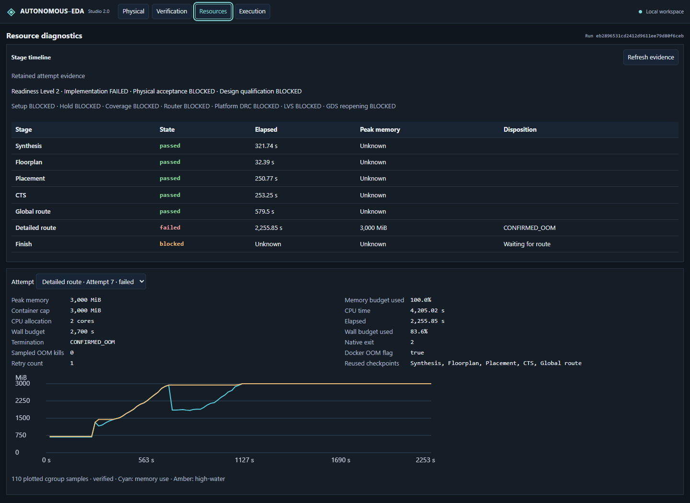

*OpenTitan AES, Milestone 11 Resources panel. The route attempt hit its cap and finish stayed blocked.* [Browser and resource provenance](docs/images/milestone-11/resource-browser-check.json)

For a standalone DEF, use a new bundle and declare the technology LEF followed by the matching cell LEF. Inputs are relative to the supplied root and get operator-selected provenance. Rehydrate archived runs with their original paths and hashes. If some stages fail to render, inspect the exit status, stage manifest and logs. Valid exports can still be opened from a partial bundle.

~~~sh
autonomous-eda artifacts snapshots .local/def-inputs experiments/def-preview \
  --checkpoint finish-def gcd.def --run-id gcd-def --top gcd \
  --lef sky130_fd_sc_hd.tlef --lef sky130_fd_sc_hd_merged.lef
~~~

## Agent and MCP guide

~~~mermaid
flowchart TD
    Controller["Controller and independent verification"] --> DB["Run SQLite, attempt receipts and artifact hashes"]
    DB --> Query["Bounded evidence reader"]
    Query --> MCP["Local read-only MCP over stdio"]
    Query --> Diagnose["Deterministic path and log diagnosis"]
    Query --> Render["Artifact renderer and Studio"]
    Diagnose --> Supervisor["AI supervisor and workflow journal"]
    Index["Approved local reference index"] --> Supervisor
    Supervisor --> Gateway["Optional bounded model gateway"]
    Gateway --> Supervisor
    Supervisor --> Review["Operator reviews evidence and cited proposals"]
    Query --> Opt["Budgeted optimizer"]
    Opt --> Review
    Review --> Execute["Approved fixed CLI operation"]
    Execute --> Controller
~~~

### Register and observe a real experiment

Use the completed GCD run and an allowlist outside its evidence directory. The absolute root must be canonical, with individually granted run IDs and an intact run inventory. On Windows use forward slashes in absolute TOML paths. A completed controller directory contains `run.sqlite3`. A historical archive instead needs its hash-backed `reference.json` and every referenced artifact.

~~~sh
mkdir -p .local
cat > .local/handbook-runs.toml <<EOF
[roots]
handbook = "$(pwd -P)/experiments"

[experiments.gcd]
root = "handbook"
directory = "gcd-walkthrough"
EOF
cat > .local/handbook-ai.toml <<'EOF'
experiments = "handbook-runs.toml"
hosted_enabled = false
EOF

python -m pip install -e '.[mcp]'
autonomous-eda mcp inspect --config .local/handbook-runs.toml
autonomous-eda mcp smoke --config .local/handbook-runs.toml gcd
autonomous-eda ai --config .local/handbook-ai.toml --journal .local/handbook-ai.sqlite3 \
  observe --experiment gcd --request-id gcd-observe
autonomous-eda ai --config .local/handbook-ai.toml --journal .local/handbook-ai.sqlite3 \
  --json diagnose --experiment gcd --check setup --request-id gcd-diagnose
autonomous-eda ai --config .local/handbook-ai.toml --journal .local/handbook-ai.sqlite3 \
  replay gcd-observe
autonomous-eda report experiments/gcd-walkthrough --profile physical --markdown
~~~

`mcp inspect` lists negotiated schemas. `mcp smoke` prints the run and timing summaries as two JSON lines. For host integration, launch `autonomous-eda mcp serve --config /absolute/path/to/handbook-runs.toml` as a local stdio child in the installed Python environment. The tool catalog exposes experiment summaries, attempts, timing and physical metrics, resources, verification gates, AES qualification and artifact metadata. Most experiment tools take `experiment_id`. Use bounded pagination where offered. Unauthorized IDs return an access error. Missing or changed inputs withdraw the measured claims. MCP cannot dispatch tools or write into a run. [Tool schemas and client example](docs/MCP.md)

The model-free observation prints `COMPLETED observed` and the design's independent `Acceptance FAILED`. For a diagnosis inspect `observation.diagnosis` in JSON. Follow evidence references to the original path lines, artifact SHA-256, metric keys, corner and units. The journal binds the policy, request, evidence snapshot and output digests. Replay is historical. `ai resume WORKFLOW_ID` revalidates evidence and any recorded selection, and rejects a changed digest as stale. `inspect` shows workflow metadata. `cancel` prevents a late selection from entering an active workflow.

### Add scoped retrieval and optional explanation

The smallest local knowledge index needs SQLite FTS5 and an explicit source registry. Semantic and hybrid modes also need the `knowledge` extra and the pinned, verified MiniLM files. Keyword retrieval works with base Python.

~~~sh
cat > .local/handbook-sources.toml <<EOF
[roots]
docs = "$(pwd -P)/docs"

[sources.contract]
root = "docs"
path = "EVIDENCE_CONTRACT.md"
kind = "markdown"
trust = "trusted_documentation"
EOF
autonomous-eda knowledge --index .local/handbook-knowledge.sqlite3 \
  --config .local/handbook-sources.toml ingest
autonomous-eda knowledge --index .local/handbook-knowledge.sqlite3 \
  --config .local/handbook-sources.toml search 'checkpoint' --mode keyword --top-k 3
~~~

For an optional live explanation, start a trusted loopback Chat Completions server that supports structured responses. For example, with llama.cpp and a local model file:

~~~sh
llama-server -m /path/to/qwen2.5-0.5b-instruct-q4_k_m.gguf \
  --alias qwen2.5-0.5b --host 127.0.0.1 --port 18116 -c 8192 -t 6 -ngl 0 --parallel 1
~~~

In another activated shell at the repository root, create a separate policy and journal so the model-free requests keep their original identity.

~~~sh
cat > .local/handbook-ai-local.toml <<'EOF'
experiments = "handbook-runs.toml"
hosted_enabled = false

[knowledge]
index = "handbook-knowledge.sqlite3"
sources = "handbook-sources.toml"
context_chars = 1800

[model]
adapter = "local"
model = "qwen2.5-0.5b"
endpoint = "http://127.0.0.1:18116/v1/chat/completions"

[limits]
deadline_seconds = 150
request_seconds = 50
max_attempts = 2
token_budget = 32768
output_tokens = 256
cost_budget_microdollars = 0
EOF
autonomous-eda ai --config .local/handbook-ai-local.toml --journal .local/handbook-local.sqlite3 \
  --json explain --experiment gcd --request-id gcd-setup-review \
  --question 'Why did GCD fail setup timing?'
autonomous-eda ai --config .local/handbook-ai-local.toml --journal .local/handbook-local.sqlite3 \
  inspect gcd-setup-review
~~~

The supervisor accepts only allowed IDs for interpretations, hypotheses and measurements. It supplies numerical facts and gate states from deterministic checks, and revalidates citations. Missing or stale facts, unresolved timing evidence and replies selecting unsupported interpretations can lead to abstention or a failed attempt. Use the original tool report to assess interpretation and the current `report` to confirm gates. Hosted inference is opt-in at policy and request level. Its per-request consent and cost limits are separate from physical approvals. [Gateway configuration and accounting](docs/MODEL_GATEWAY.md) · [Retrieval schemas and pinned model](docs/KNOWLEDGE.md)

### Review a digest-bound correction

The published crash log contains `Signal 11 received` after reading the floorplan. The triage classifies it as `OPENROAD_PROCESS_SIGNAL` and cites line 8. The supported replay uses a fresh renderer process for the verified floorplan checkpoint. This workflow changes a rendered artifact and its receipts.

~~~sh
autonomous-eda artifacts triage docs/evidence/physical-snapshots \
  --log floorplan openroad-teardown.log --tool OpenROAD \
  --output experiments/teardown-diagnostic
autonomous-eda artifacts correction plan experiments/teardown-diagnostic \
  docs/evidence/physical-snapshots experiments/gcd-walkthrough \
  experiments/teardown-review experiments/gcd-corrected-floorplan \
  --stage floorplan --width 750
~~~

Inspect the plan and replace `PLAN_SHA256` with its printed `plan_sha256`. Approval binds the diagnosis and log hashes, run and attempt, checkpoint, width and isolated output. To record a rejection, use `--decision reject` in the review command. Execute only a plan whose rendered result you intend to produce.

~~~sh
autonomous-eda artifacts correction review experiments/teardown-review \
  --digest PLAN_SHA256 --decision approve
autonomous-eda artifacts correction execute experiments/teardown-review --digest PLAN_SHA256
autonomous-eda artifacts workspace experiments/gcd-snapshots --run experiments/gcd-walkthrough \
  --correction experiments/teardown-review
~~~

Review Studio's correction readback for the observed, diagnosed, proposed, reviewed, executed and verified states. Check both render hashes and re-read the independent run acceptance. If inputs change after approval, create a new plan. The controlled evaluation retained both a rejected plan and an approved replay. [Native crash log](docs/evidence/physical-snapshots/openroad-teardown.log) · [Correction and verification receipt](docs/evidence/integration/verified-correction.json)

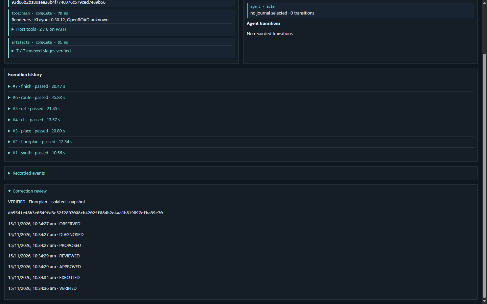

*Retained GCD correction replay, Studio desktop. The operator approved the isolated renderer action, and the output hashes verified.* [Capture provenance](docs/evidence/integration/verified-correction.json)

## Optimization

The optimizer varies approved settings and evaluates power, performance and area (PPA) with the existing physical controller. Each candidate runs in a separate directory under a finite campaign and candidate budget. The GCD policy accepts a bounded `CORE_UTILIZATION` list. `grid` visits the declared order, `random` uses a seeded shuffle, `guided` queries a local model for an allowed value, and `paired` splits fixed and guided selections. A rejected proposal falls back to an allowed deterministic candidate. The controller owns implementation and verification.

Plan a four-candidate grid after the GCD tutorial. Inspect the JSON design identity, constraints, objectives, proposed values and budget. Set `PLAN_DIGEST` to the reported `plan_digest` only if you approve the exact plan.

~~~sh
autonomous-eda optimize plan experiments/gcd-search \
  --baseline experiments/gcd-walkthrough --utilization 30 46 24 34 \
  --strategy grid --max-candidates 4 --seconds 3600 --candidate-seconds 900 \
  --memory-mib 1200 --json
autonomous-eda optimize status experiments/gcd-search
autonomous-eda optimize approve experiments/gcd-search --digest PLAN_DIGEST
autonomous-eda optimize run experiments/gcd-search --no-render
autonomous-eda optimize report experiments/gcd-search --json
autonomous-eda optimize frontier experiments/gcd-search --profile physical
autonomous-eda artifacts render experiments/gcd-search --all
~~~

`optimize resume` continues the existing campaign reservation. `cancel` revokes it. `report` records successful, failed and rejected candidates. Objective values must have compatible inputs and units. A feasible candidate must also meet mandatory gates. The Pareto frontier contains feasible candidates that no other feasible candidate improves across all selected objectives. Figures can still show infeasible points with explicit status.

*Sky130HD GCD campaign `3563e8e28ec145239fc5f6f1a0ab9f69`, original 1.1 ns clock. Four candidates completed and passed hold and layout checks. All failed setup, leaving the feasible frontier empty.* [Measured campaign](docs/OPTIMIZATION_EVALUATION.md) · [Figure provenance](docs/images/examples/optimization/provenance.json)

The measured campaign used a paired strategy and included a live-model choice at 42% and a deterministic fallback at 24%. The best setup candidate at 30% gained 0.02657 ns while increasing area by 48.80 µm². The 24% run saved 175.16 µm² and gave up 0.00481 ns of setup slack relative to the baseline. The points measure trade-offs among infeasible designs. Ibex supports candidate planning and retained comparisons. The approval scope for live execution is GCD.

## CLI reference

Run `autonomous-eda --help` for families, then `autonomous-eda FAMILY --help` or `autonomous-eda FAMILY ACTION --help` for positional arguments, choices and defaults. `python -m autonomous_eda` invokes the same parser. Use paths relative to the shell unless the configuration contract defines another root. In the tables, `RUN` is a controller experiment, `OUT` is a destination, and uppercase tokens identify user-supplied values. On narrow screens, scroll wide tables horizontally and open figures for full-size labels.

Most commands return 0 when the requested operation completes, 2 on invalid inputs, and 130 on interruption. A report or diagnosis can complete and display a failed design gate. `run` and physical `resume` return 1 for an incomplete implementation. Profiled `verify` returns 1 for failed or blocked acceptance. Doctor has separate readiness codes. Inspect captured evidence for the native process exit.

### Setup, ingestion and execution

| Family | Usage |
| --- | --- |
| `doctor` | `doctor --engine docker --json` `--engine` accepts `auto` (default), `docker` or `podman`. `--platform` accepts `sky130hd` (default) or `nangate45`. `--workspace` defaults to current directory. `--orfs-root` checks local files. Emits checks and remediation. Exits 0, 2 or 3. |
| `ingest` | `ingest export.json design.toml --revision REV --generated-core-prefix lowrisc:prim_abstract:` Normalized EDAM 0.2.1 from a local synthesis export, revision required, repeatable prefix. Writes a new manifest under the export root and prints hashes and source order. |
| `inspect` | `inspect examples/counter.toml --netlist experiments/counter-netlist.json` Native Yosys, optionally sv2v. `--timeout` defaults to 120 s per frontend. `--translated-verilog` saves sv2v output. ORFS manifest inspection validates a plan without executing. |
| `plan` | `plan configs/gcd-sky130hd.toml` Requires an ORFS manifest. Plans in JSON with dependency and expected output lists. |
| `run` | `run configs/gcd-sky130hd.toml experiments/gcd-walkthrough --memory-mib 1200` Fresh directory, cached pinned Docker image on Linux or WSL2. `--translated-rtl` takes the exact pinned AES translation for the AES configuration. Writes run inventory and attempts as JSON. |
| `resume` | `resume experiments/gcd-walkthrough` Uses saved inputs and verifies checkpoint hashes. With a native RTL run, replays an applicable verification profile. `--profile` and `--markdown` select acceptance readback, including on physical resume. |
| `verify` | `verify experiments/gcd-walkthrough --profile physical --coverage --decks --markdown` Unprofiled `verify RUN` invokes platform decks. `--coverage` runs pinned OpenSTA coverage. `--decks` reruns DRC and LVS in profiled verification. `--render` exports figures with the visualization dependencies. |
| `report` | `report experiments/gcd-walkthrough --engineering` Engineering Markdown includes attempts, metrics and gates. `--profile PROFILE --markdown` reads an acceptance matrix. `--structured` or `--artifact PATH` expose versioned readback with `--limit` 16 and `--offset` 0 by default. Engineering and structured modes require their own query. |

| Budget or report flag | Valid scope | Meaning |
| --- | --- | --- |
| `--memory-mib` | `run`, `resources plan`, `resources retry`, `optimize plan` | Docker RAM cap in MiB. Defaults to 3,500 for `run` (range 128 to 1,048,576) and 1,200 for optimization planning. Resource planning uses the saved cap when omitted. Ordinary `resume` uses stored allocation. |
| `--wall-clock-seconds` | `run` and physical `resume` | Stop the current invocation at its wall deadline. Omitted means no new invocation deadline. Manifest and saved retry budgets still apply. |
| `--max-artifact-mib` | `run` and physical `resume` | Stop when periodic run-tree byte accounting reaches the configured budget. Omitted means no new invocation artifact cap. |
| `--max-tool-processes` | `run` and physical `resume` | Set Docker pids limit for processes and threads, up to 65,536. |
| `--max-retries` | `run` and physical `resume` | Additional dispatches per stage (0–100). Zero permits the first attempt. Saved retry policy remains binding. |
| `--profile` | `verify`, `report`, `resume` and `optimize frontier` | Acceptance supports `rtl`, `rtl-formal`, `physical` and `full`. Frontier limits choices to `physical` (default) and `full`. |
| `--coverage` | `verify` | Run pinned OpenSTA coverage on eligible physical evidence. |
| `--decks` | `verify` | Rerun the independent pinned DRC and LVS decks. |
| `--render` | `verify`, `optimize run`, `optimize resume` | Request figures with the visualization dependencies. Optimization also accepts `--no-render`. |
| `--markdown` | `verify`, `report`, `resume` | Emits an acceptance matrix. Select the intended profile explicitly. |
| `--engineering` | `report` | Engineering Markdown using retained run evidence. |

### Evidence, artifacts and independent checks

| Family | Usage |
| --- | --- |
| `resources` | `resources history experiments/gcd-walkthrough --samples 2` `history RUN` returns paged attempts (limit 16, offset 0, zero samples by default). `plan RUN` and `retry RUN OUT` accept `--stage` (default `route`), required `--stage-seconds`, `--wall-seconds` and `--artifact-mib`, optional `--memory-mib` and `--margin` (0.1 default). `--policy` accepts `evidence-required` or `bounded-trial` and is required for retry. Plan emits a verdict. Retry emits plan and implementation state and can return 1. |
| `readiness` | `readiness qualification experiments/gcd-walkthrough` `macro MANIFEST OUT` runs native macro view readback. `partitions TOPGEN EDAM --revision REV` inventories native boundaries. `qualification RUN` emits implementation, physical, design and readiness results. AES actions are below. |
| `experiments` | `experiments list experiments` `list ROOT` inventories reports. `import-reference ARCHIVE INDEX` binds a historical archive. `compare BASELINE CANDIDATE` requires compatible inputs for a controlled comparison. `--descriptive` permits labeled descriptive comparison. |
| `artifacts` | `artifacts snapshots experiments/gcd-walkthrough experiments/gcd-snapshots` `render DIR` accepts one of `--all` (default), `--layout` or `--reports`. `gallery DIR` rehashes published evidence. `snapshots RUN OUT` supports `--width` (1,000 default) and repeatable explicit `--checkpoint STAGE PATH` or `--lef PATH` with `--top` and `--run-id`. Returns 1 for missing or failed exports. |
| `diagnose` | `diagnose experiments/gcd-walkthrough --check setup --json` Parses retained timing. `--check` selects `setup` (default), `hold`, `recovery`, `removal`, `max_delay`, `min_delay`, `gating_setup` or `gating_hold`. `--path` and `--stage-trends` are alternate views. Returns cited observations and hypotheses. |
| `benchmark` | `benchmark build experiments/gcd-benchmark --case gcd=experiments/gcd-walkthrough` `build OUT --case LABEL=RUN` (repeatable), optionally `--campaign CAMPAIGN`. Exports JSON, CSV, Markdown and bound figures when available. `figures OUT` validates the report digest and rebuilds charts with `visuals`. |

| Nested action | Important arguments and result |
| --- | --- |
| `readiness aes-contract` | `RUN --source-manifest TOML --edam JSON --resolved JSON --inspection JSON --topgen JSON --upstream CHECKOUT`. Optional `--native-output OUT` invokes independent pre-route OpenSTA. `--diagnostic-budget JSON` requires that output and applies experimental min/max delays and uncertainty. |
| `readiness aes-core` | `DV_BUILD [--timeout SECONDS]` runs the upstream cipher-core test on a fresh FuseSoC export. |
| `readiness aes-peripheral` | `RUN --source-manifest TOML --edam JSON --resolved JSON --inspection JSON --testbench FILE --output OUT`. Runs native original and translated-model checks. Opt into five scenarios and bounded partition proof with `--multi-clock`. `--seed` defaults to 41. |
| `readiness aes-record` | `RUN --contract JSON` plus `--core`, `--peripheral` and `--resource-plan` receipts where available. Prints the bound qualification summary. AES native timeouts default to 240 s. |
| `artifacts workspace` | `BUNDLE [--run RUN] [--repository DIR] [--journal DB] [--correction DIR] [--port PORT]`. A local server prints its URL. Defaults to current repository and port 8765. |
| `artifacts triage` | `ROOT --log STAGE PATH` (repeatable) with optional `--tool`, `--output OUT` and local `--local-model` and `--local-endpoint`. Cites native log lines and proposed actions. |
| `artifacts triage-approve` | `BUNDLE --digest DIGEST` records a reviewed diagnostic approval. |
| `artifacts correction` | `plan DIAGNOSIS LOG_ROOT RUN REVIEW OUT --stage STAGE [--width PX]`, `review REVIEW --digest DIGEST --decision approve` or `reject`, and `execute REVIEW --digest DIGEST`. Binds and rechecks one renderer replay. |

### Optimization, IO and agents

| Family | Usage |
| --- | --- |
| `optimize` | `optimize frontier experiments/gcd-search --profile physical` `plan CAMPAIGN --baseline RUN --utilization INT [INT …]` plus strategy, seed, max candidates, seconds, candidate seconds, memory, objectives and optional local model/endpoint. Actions are `status`, `approve --digest`, `run`, `resume`, `cancel`, `report`, `compare` and `frontier`. Use `--json` where shown in action help. See the command sequence in [Optimization](#optimization). A failed campaign returns 1. |
| `io` | `io plan examples/io/placement.toml experiments/icewall` `doctor`, `plan CONFIG OUT`, `approve OUT --digest DIGEST`, `run OUT`, `resume OUT`, `report OUT`, `verify OUT` and `render OUT [--all]`. `chip PLACEMENT CONFIG OUT [--require-acceptance]` and `chip-render OUT` cover chip assembly. Tool dispatch needs the pinned image. A failed placement check or required chip acceptance returns 1. |
| `ai` | `ai --config .local/handbook-ai.toml --journal .local/handbook-ai.sqlite3 replay gcd-observe` Put required `--config`, `--journal` and optional `--json` before the action. `status` lists routes and counts. `observe`, `explain` and `diagnose` take `--experiment` and optional `--request-id`. `explain` requires `--question` and supports repeated `--filter`. `explain` and `diagnose` accept `--consent-hosted`. `inspect`, `resume`, `replay` and `cancel` take a workflow ID. Failed or stale results return 1. |
| `knowledge` | `knowledge --index .local/handbook-knowledge.sqlite3 search checkpoint --top-k 3` Required `--index` and optional `--config`, `--model-dir` and `--json` precede actions. `status [--verify]`, `ingest [SOURCE]`, `reindex [--rebuild]`, `delete SOURCE`, `inspect SOURCE`, `search QUERY` and `evaluate BENCHMARK [--repetitions N]`. Search modes are `keyword` (default), `semantic` and `hybrid`. Uses citations and source trust. |
| `mcp` | `mcp smoke --config .local/handbook-runs.toml gcd` Install `mcp` extra. `serve` and `inspect` require `--config`. `smoke` also takes an experiment ID. Starts stdio or prints schema and bounded JSON evidence. |

~~~sh
autonomous-eda --help
autonomous-eda run --help
autonomous-eda resources retry --help
autonomous-eda artifacts correction plan --help
autonomous-eda readiness aes-peripheral --help
~~~

## Troubleshooting

Start with the exact attempt, native log, related report and controller classification. A native exit code describes a process. A classification combines available execution evidence. An acceptance result is a separate evaluation of design checks. Preserve the first failure and rerun only after identifying which inputs or environment changed.

### Environment and RTL inputs

| Symptom and evidence | Diagnose and recover |
| --- | --- |
| Docker absent, access denied or wrong context | Use `docker version`, `docker context show` and `autonomous-eda doctor --json --engine docker` inside the target Linux environment. A required UNKNOWN points to blocked inspection. Start the correct engine, enable WSL integration if needed, and confirm the version and workspace bind checks. |
| Image missing or incompatible | The adapter can report `pinned image inspection did not verify Linux/amd64`. Read `docker image inspect "$orfs_image" --format '{{.Os}}/{{.Architecture}}'`, pull the exact digest for `linux/amd64` where supported, and rerun Doctor. Keep the reference identity. |
| Missing host binaries or Python packages | `Yosys is required for RTL inspection` identifies missing host Yosys. Use `command -v yosys iverilog vvp sv2v` for the relevant tools, `python --version` and `python -m pip check` for the active environment. Install matching host tools and the necessary extra. Re-run the specific frontend or readback command. |
| Missing libraries, unusable WSL or a bind issue | Check Docker visibility from WSL, workspace permissions, the pinned platform config and the required LEF and Liberty reports. Doctor can inspect a local tree with `--orfs-root`. On Windows, `wsl --list --verbose` helps distinguish WSL2, missing distro state and host denial. Re-run Doctor after confirming the intended engine and libraries. |
| Manifest source missing or out of tree | Inspect the `sources path missing or outside design directory` diagnostic. Restore the relative file or regenerate the exact export and repeat `inspect`. Compare the manifest order, relative includes and input fingerprints. |
| Wrong top, missing module or black box | `Yosys elaboration failed` precedes the native detail. Run the hierarchy check in [RTL ingestion](#rtl-ingestion-and-elaboration). Validate the exact top, dependency closure and declared macros. A logical stub needs physical cell, LEF, Liberty and layout evidence for implementation. |
| Source-order, generator or translation issue | Read the first unresolved package/include or `sv2v translation failed`. Verify the FuseSoC native file list, generator environment and translation digest. An unsupported SV construct requires a supported frontend or revised input configuration. For the documented AES generator seed issue, use the pinned environment and compare two clean resolved receipts. |
| Missing views during mapping or stream-out | Compare native cell or macro names in the mapped Verilog with the library and physical GDS inventory. Use `readiness macro MANIFEST OUT` for an explicit macro inventory. Re-run planning and physical checks only after the missing views have been bound. |

### Geometry, timing and physical verification

The placement and deck scenarios in this table describe diagnostic procedures for failure classes. Use the actual native log for the current run.

| Stage and symptom | Diagnose and recover |
| --- | --- |
| Floorplan geometry or placement capacity | Inspect `2_1_floorplan.json`, row/site geometry and PDN or macro logs, then use the stage preview. Check that usable area remains after margins and blockages. Experiment with supported geometry settings in an isolated configuration. Confirm a valid floorplan and legal placement. |
| Illegal placement or pin access | Read the first violation in the detailed-place or route log. Find the instance or pin in Studio. Check routing access layers, site alignment, blockages and local density. Verify the new stage's native legality or router evidence after a reviewed correction. |
| Unclocked endpoints, absent I/O budgets or questionable exceptions | Run `verify RUN --profile physical --coverage --decks --markdown` on a final checkpoint, or the native AES contract probe for a supported pre-route investigation. Compare identified clocks, uncovered pins and I/O delays with the integration specification. Qualify changes in a new experiment. |
| Setup or hold violation | Read `6_finish.rpt` and `6_report.json`, and run `diagnose RUN --check setup` or `--check hold`. GCD recorded `Final setup violation, worst slack -1.20488 ns`. Inspect the same endpoint and corner, then validate a proposed placement, sizing or constraint experiment against both min and max timing. |
| Extraction incomplete | Rehash final ODB, SDC and SPEF. Read the OpenRCX log and `readiness qualification RUN`. A pre-route estimate cannot supply a missing extracted gate. Rebuild from the last valid stage and confirm bound extraction and coverage. |
| Router timeout, OOM or violations | Run `resources history RUN --samples 8` and inspect the final route log and `5_2_route.json` if present. A terminal route checkpoint and native zero-violation count are needed to pass the router gate. Use admission and an isolated retry to change execution limits. The [AES table](#placement-routing-attempts-and-admission) gives the separate observed outcomes. |
| Platform DRC or LVS fails | Read the independent deck receipt, violation database or LVS comparison output, and verify the intended GDS/netlist pair. Locate affected geometry, layer mapping or differing devices and nets. Repair in an isolated run and repeat the independent decks. Preserve the original failure. |
| GDS stream-out or reopen fails | Check `6_final.gds`, layer map and master-cell inventory, then read the hash-bound `gds-validation.log` where present. Regenerate from verified inputs and confirm separate reopening. A stale GDS file must not be used for acceptance. |
| RTL regression or formal mismatch | Check oracle and proof logs before changing the candidate. The fixture's `LOGIC_MISMATCH a=1 b=1 expected=0 observed=1` agrees with its SAT counterexample. Confirm exact port and reference identity, fix the candidate and use native `resume`. A proved small combinational boundary leaves sequential behavior outside that proof. |

### Evidence integrity and the renderer

| Symptom | Diagnose and recover |
| --- | --- |
| Missing or corrupt checkpoint and stale gates | Use `report RUN --artifact RELATIVE_PATH` and check integrity. Reopen the retained receipt and compare the correct artifact hash. With unchanged run identity, `resume RUN` rebuilds from the earliest invalid checkpoint. A changed RTL, constraint or tool identity needs an isolated experiment. Keep the original archive intact. |
| Interrupted execution or exhausted retries | Read attempt state, exit classification and recovery receipt. Run `resume RUN --help` and apply finite invocation limits suitable for the original configuration. Saved retry deadlines and caps remain binding. |
| Resource admission refused | Read the plan's memory overlap, reserve, checkpoint and disk verdicts. Confirm free memory and storage before considering a new admission request. A refused plan never establishes a route result. |
| Rejected optimization plan or empty frontier | Inspect `optimize status CAMPAIGN` and `optimize report CAMPAIGN --json`. Compare approval digest, baseline identity, candidate limits and independent gates. An infeasible measurement belongs in the report with its gate failures. |
| OpenROAD renderer crash | The retained log stops at `Signal 11 received`. Run the [triage and digest-bound replay](#review-a-digest-bound-correction). The isolated replay must verify the new PNG and geometry hashes. A successful image replay leaves design acceptance to the separate physical checks. |

Do not disable DRC, LVS, clock coverage or hash validation to obtain a passing summary. Restore the evidence or fix the measured problem, then rerun the applicable check. [Timing and log diagnostics](docs/PHYSICAL_DIAGNOSIS.md) · [Evidence invalidation rules](docs/EVIDENCE_CONTRACT.md)

## Resource planning and recovery

Docker's memory cap bounds the container inside the Linux engine. Linux or WSL must also have headroom for host processes, page cache and other containers. Docker `MemorySwap` is combined memory and swap. The physical recipes record their limits and samples. A route that consumes its cap establishes a lower bound on the resources needed for another attempt under the same conditions.

| Observation | Interpretation |
| --- | --- |
| Exit 124 | A controller timeout when the controller records enforcement of its deadline. |
| Exit 137 | A process was killed with SIGKILL. Check Docker and cgroup data before classifying an OOM. |
| Docker `OOMKilled` and cgroup events | Direct OOM evidence when recorded and associated with that invocation. |
| Cgroup `memory.current` and `memory.peak` | Current and high-water memory in bytes for the container. Older histories can lack these fields. |
| Sampled RSS and CPU | RSS samples can miss peaks and include shared pages more than once. CPU usage and throttling are cgroup counters, recorded in microseconds and events. |
| Artifact and retry limits | Retained files count toward the sampled logical byte cap. A process and thread limit bounds Docker tasks. A zero retry limit still permits the first attempt. |

Use the existing failed run as the retry source. The AES example is read-only until the retry invocation. Preserve the source, keep the fixed ORFS inputs and choose a fresh destination. On the previously measured host the first command reported insufficient headroom for 3,240 MiB.

~~~sh
failed=experiments/m11b-aes-route-01
autonomous-eda resources history "$failed" --limit 16 --samples 8
autonomous-eda resources plan "$failed" --stage route \
  --memory-mib 3240 --stage-seconds 2700 --wall-seconds 3700 \
  --artifact-mib 2048 --margin 0.08 --policy bounded-trial
~~~

The planner verifies the predecessor checkpoints and compares a finite target budget against observed runtime, memory, CPU, disk and host reserve. `READY` supports the `evidence-required` policy. `RESOURCE_CONSTRAINED` may qualify for an explicit `bounded-trial` with verified lower-bound observations. `INSUFFICIENT_RESOURCES` or `UNKNOWN` needs additional capacity or evidence. Confirmed OOM rules out its cap and smaller caps for an equivalent retry. Admission is a dispatch decision with finite limits.

Only run the next example if your current plan admits the exact trial. It rechecks live headroom and binds the policy to the isolated copy. Resume uses the retained trial budget and stage history. Choose another fresh destination and re-plan after its limits expire.

~~~sh
autonomous-eda resources retry "$failed" experiments/aes-route-trial --stage route \
  --memory-mib 3240 --stage-seconds 2700 --wall-seconds 3700 \
  --artifact-mib 2048 --margin 0.08 --policy bounded-trial
autonomous-eda resources history experiments/aes-route-trial --samples 8
autonomous-eda resume experiments/aes-route-trial
~~~

For ordinary interruption, wait for the old process to stop, then run `resume` on the same directory. The controller records interrupted state and can recover surviving telemetry before removing a retained container. It reuses successful upstream attempts when their input and output hashes match. [Resource telemetry contract](docs/RESOURCE_TELEMETRY.md) · [Measured GCD recovery](docs/evidence/gcd-recovery/recovery.json)

## Evidence store and native reports

A new physical run has a UUID, saved manifest and computation identity. The identity includes design, revision, authoritative source configuration, image digest, platform/library, constraints and execution configuration. Explicit RTL manifests also fingerprint ordered source bytes, includes, generation outputs, parameters and defines. `run.sqlite3` inventories attempts and checkpoints. The versioned schema 1 readback, verification and telemetry receipts each carry their own contract. Earlier databases or reference indexes expose only the evidence they retained.

The GCD experiment looks like this with selected paths shown. `aeda-ID` represents the unique container attempt name.

~~~text
experiments/gcd-walkthrough/
  manifest.toml
  run.sqlite3
  attempts/aeda-ID/
    route.log
    route.resources.ndjson
    route.resources.json
  results/sky130hd/gcd/base/
    1_synth.odb
    3_place.odb
    6_final.odb
    6_final.sdc
    6_final.v
    6_final.spef
    6_final.gds
  logs/sky130hd/gcd/base/
    1_synth.json
    5_2_route.json
    6_report.json
  reports/sky130hd/gcd/base/
    5_route_drc.rpt
    6_finish.rpt
  verification/
    latest.json
    attempts/
  verification-drc.json
  verification-lvs.json
  visualizations/
    layout_overview.png
    visualization_manifest.json
experiments/gcd-snapshots/
  snapshots.json
  finish.json
  finish.png
  gds.png
~~~

Inspect `attempts` for native commands, exit status, timestamps, stage ownership and artifact hashes. The separate verification trees retain the exact deck, coverage and reopening evidence referenced by the readback. Sample journals use JSON Lines, and terminal resource receipts include allocation, cleanup and classification. The verified setup metric record includes these fields.

~~~json
{
  "name": "setup_worst_slack_ns",
  "value": -1.20488,
  "unit": "ns",
  "stage": "finish",
  "corner": "tt_025C_1v80",
  "artifact": "logs/sky130hd/gcd/base/6_report.json",
  "method": "orfs-normalization-v1",
  "reference": "finish__timing__setup__ws",
  "status": "MEASURED"
}
~~~

A receipt can be present while its source artifact has been modified, superseded or removed. Evidence readback then withdraws the affected measurements or gates. Failed attempts preserve the source of a disposition and the last recoverable predecessor. Keep their logs separate from later attempts.

~~~sh
autonomous-eda experiments list experiments
autonomous-eda report experiments/gcd-walkthrough --structured --limit 8 --offset 0
autonomous-eda report experiments/gcd-walkthrough \
  --artifact logs/sky130hd/gcd/base/6_report.json
autonomous-eda report experiments/gcd-walkthrough --engineering
autonomous-eda benchmark build experiments/gcd-benchmark \
  --case gcd=experiments/gcd-walkthrough
autonomous-eda benchmark figures experiments/gcd-benchmark
~~~

Benchmark exports comprise `report.json`, `report.md`, `runs.csv`, `stages.csv` and a digest-bound figure inventory. A PNG receipt names the source observations, renderer settings and image hash. Studio canvas exports embed checkpoint provenance. Controlled comparison requires compatible RTL, platform, constraints and verified observations. Use `experiments compare BASELINE CANDIDATE --descriptive` to label cross-design comparisons explicitly. [Evidence schema](docs/EVIDENCE_CONTRACT.md) · [Benchmark export contract](docs/BENCHMARK_REPORTING.md)

## Results and benchmarks

| Design and scope | Target (ns) | Measured outcome | Qualification limit |
| --- | ---: | --- | --- |
| [GCD stage and GDSII gallery](#complete-physical-flow), Sky130HD | 1.1 | Complete, 4,414.23 µm² standard-cell area, 7,425 µm detailed wirelength, −1.20488 ns setup, +0.429847 ns hold | Hold, coverage, router, DRC, LVS and reopen passed in the walkthrough. Setup failed. |
| Ibex core, Sky130HD | 8.0 | Complete, −0.377013 ns setup and +0.426791 ns hold | Platform DRC, LVS and reopen passed. The historical index lacks bound data for final coverage. |
| [OpenTitan AES](#opentitan-aes), Sky130HD | 8.5 | Five stages complete, +0.0053717 ns estimated global-route setup. Confirmed OOM at 3,000 MiB on one distinct retry. | Level 2. Final extraction, checks and qualification blocked. |
| [GCD optimization](#optimization), Sky130HD | 1.1 | Four complete candidate implementations with measured area/slack trade-offs | All failed setup. No feasible candidate for the physical or full frontier. |
| ICeWall Sky130 IO placement and separate chip probe | — | Four pads, four corners and 156 continuity cells in the abstract placement. Inset chip run routed two nets over 1,317 µm and reopened a 1,200 × 1,200 µm GDSII. | Inset chip power connectivity failed. Full-chip DRC, LVS and STA blocked. |
| [Studio](#physical-design-studio), GCD and AES | 1.1 / 8.5 | Real browser readback of verified layout, path, execution and resource evidence | Partial AES remains distinguishable from completed but setup-failed GCD. |
| [Verification fixture](#functional-and-formal-verification) | — | Real Icarus mismatch and SAT counterexample, followed by a retained successful repair | Scoped exact-port combinational proof and functional test. |

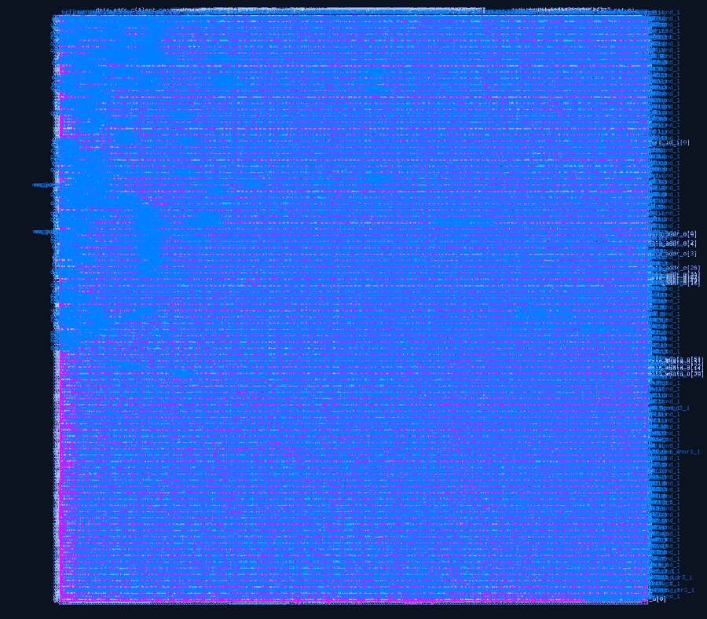

*Ibex at 8 ns, final KLayout view from the historical Sky130HD reference. GDS reopening and decks passed. Extracted setup failed.* [Reference evidence](docs/evidence/ibex-sky130hd-index.json) · [Figure provenance](docs/images/examples/ibex/provenance.json)

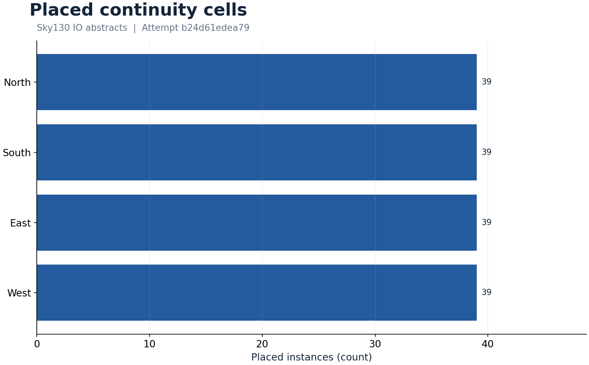

*Sky130 IO placement, four pads, four corners and 156 continuity cells. DEF checks passed, with chip-level layout and electrical checks blocked for these views.* [Placement evaluation](docs/IO_PAD_RING_EVALUATION.md) · [Figure provenance](docs/images/examples/io-placement/provenance.json)

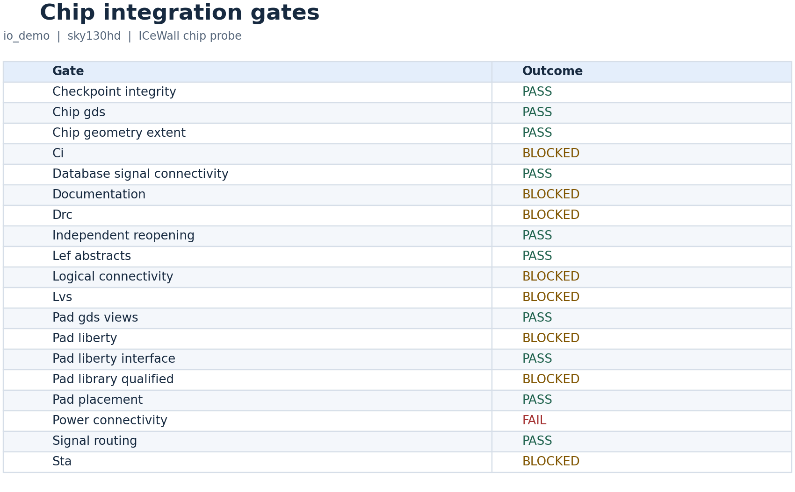

*Separate inset IO chip probe with upstream GDS and Liberty collateral. Two routed signals and independent reopening passed. The power gate failed and full-chip acceptance was blocked.* [Chip evaluation](docs/IO_CHIP_EVALUATION.md) · [Figure provenance](docs/images/examples/io-integration/provenance.json)

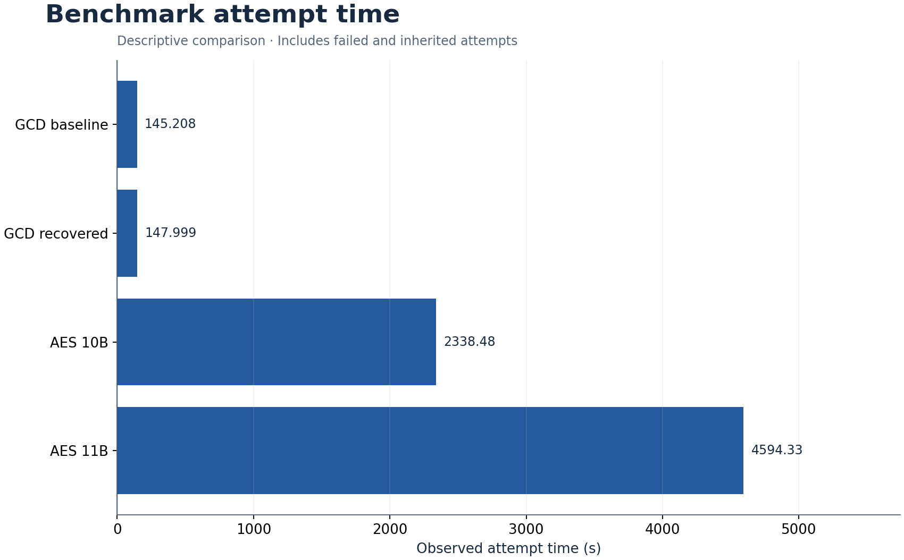

*Milestone 11 attempt durations include inherited and failed work. These are descriptive comparisons across different workloads and resource conditions.* [Benchmark results](docs/evidence/milestone-11-benchmark/report.md) · [Figure provenance](docs/evidence/milestone-11-benchmark/visualizations/visualization_manifest.json)

## Architecture and development

`src/autonomous_eda/cli.py` defines the command surface. Manifest and frontend modules resolve and hash inputs. The ORFS adapter and experiment controller own execution and checkpoint recovery. The evidence and verification modules build measured schema 1 readback. Resource, benchmark, diagnosis, optimization, AI, MCP and Studio each consume that recorded evidence through bounded interfaces.

For contributors and coding agents, follow [AGENTS.md](AGENTS.md). Start with Git status/remotes, project state and roadmap. Inspect the active issue, PR, checks and unresolved reviews before branching. Work from validated `main`, use one reviewable milestone PR at a time, link the issue and post material progress. Keep runs isolated, preserve failed attempts and native logs, and use authoritative sources and constraints. Publish measured claims with tool and input identities. Keep generated databases and private artifacts out of Git. Record missing views and unverified gates explicitly. Merge after the repository's required checks and approval policy are satisfied.

~~~sh
python -m pip install -c .github/ci-constraints.txt -e '.[dev,mcp,visuals]'
python -m pip check
ruff check .
ruff format --check .
python -m mypy
python -m pytest -q
python -m pytest -q tests/test_documentation.py tests/test_visual_artifacts.py
~~~

The hosted workflow covers Python 3.11 and 3.12 on Linux and Python 3.12 on Windows, with a bootstrap documentation job. The base suite uses compact fixtures and optional native probes. Run the specific pinned tools for any physical claim, keep the native receipts and document what was exercised. For visual changes, check GitHub Markdown headings, links, tables, Mermaid and mobile layout. [Contribution workflow](CONTRIBUTING.md) · [Design system](docs/DESIGN_SYSTEM.md) · [Project state](docs/PROJECT_STATE.md) · [Roadmap](docs/ROADMAP.md) · [Handbook engineering receipt](docs/README_OVERHAUL_EVALUATION.md)
