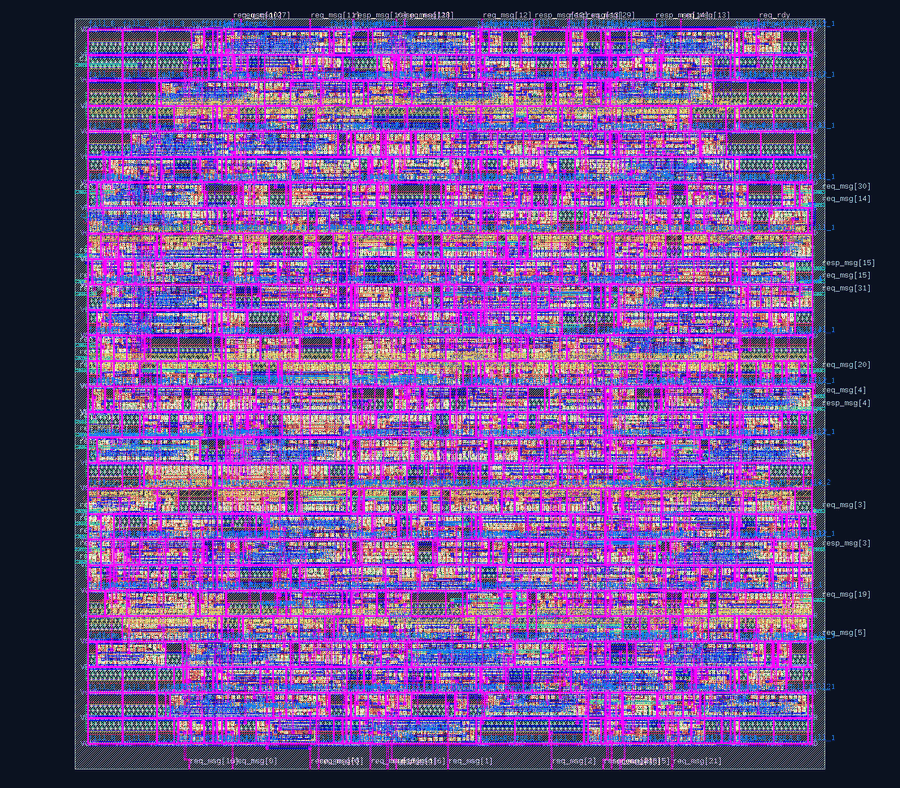

# AUTONOMOUS-EDA

AUTONOMOUS-EDA is a deterministic Python controller for reproducible RTL-to-GDSII experiments with OpenROAD Flow Scripts (ORFS). It records tool inputs, implementation checkpoints, and independent verification results so you can reproduce and compare physical-design runs.

The retained SkyWater 130 HD GCD and Ibex designs produced GDSII that reopened in KLayout. Both passed hold, design rule checking (DRC), and layout versus schematic (LVS). GCD missed setup by 1.20488 ns at a 1.1 ns clock. Ibex missed setup by 0.377013 ns at an 8 ns clock. All four GCD optimization candidates also missed setup. [Measured results](docs/VERIFICATION_EVALUATION.md)

## Capabilities

- Inspect ordered RTL sources with Yosys and plan the fixed ORFS stages.
- Run and resume implementation using hash-validated checkpoints.
- Evaluate independent timing, DRC, LVS, regression, equivalence, and artifact checks.
- Compare compatible power, performance, and area (PPA) results in bounded campaigns.
- Read approved evidence over MCP, search offline engineering references, or use a local model to explain recorded findings.

## Installation and quick start

Install Python 3.11 or later and run the environment checks. Native Yosys supports RTL inspection. Physical execution and coverage require Linux or WSL2, Docker, and the cached pinned ORFS image. [Environment Doctor](docs/ENVIRONMENT_DOCTOR.md)

~~~sh
python -m pip install -e .
autonomous-eda doctor
autonomous-eda inspect examples/counter.toml
autonomous-eda plan configs/gcd-sky130hd.toml
~~~

## Run and verify a design

~~~sh
autonomous-eda run configs/gcd-sky130hd.toml experiments/gcd-run --memory-mib 1200
autonomous-eda verify experiments/gcd-run
autonomous-eda verify experiments/gcd-run --profile full --coverage
autonomous-eda report experiments/gcd-run --profile full --markdown
autonomous-eda resume experiments/gcd-run
~~~

The stage planner defines synthesis, floorplanning, placement, clock-tree synthesis, global routing, detailed routing, and finish. The controller verifies checkpoint inputs and outputs before reuse. Static timing analysis (STA) reports setup and hold independently. A complete stage plan and a passing acceptance profile are separate outcomes. [Architecture](docs/ARCHITECTURE.md) · [Evidence contract](docs/EVIDENCE_CONTRACT.md)

For an RTL-only exercise, copy the [verification fixture](examples/verification/manifest.toml) and use the `rtl-formal` profile. For physical optimization, approve a bounded plan and inspect the feasible frontier. [Verification](docs/VERIFICATION_AND_ACCEPTANCE.md) · [Optimization](docs/OPTIMIZATION.md)

## Example results

*GCD layout. KLayout reopened the retained SkyWater 130 HD GDSII.*

*GCD timing. Final setup worst slack was −1.20488 ns at the original 1.1 ns clock.*

*GCD optimization. The baseline and four candidates all have negative setup slack.*

[Gallery and figure provenance](docs/EXAMPLE_GALLERY.md)

## Documentation

| Topic | Guide |
| --- | --- |
| System architecture and evidence | [Architecture](docs/ARCHITECTURE.md) · [Evidence contract](docs/EVIDENCE_CONTRACT.md) |
| Experiments and recovery | [Experiment protocol](docs/EXPERIMENT_PROTOCOL.md) · [Environment Doctor](docs/ENVIRONMENT_DOCTOR.md) |
| Timing, verification, and optimization | [Timing diagnosis](docs/TIMING_DIAGNOSIS.md) · [Verification](docs/VERIFICATION_AND_ACCEPTANCE.md) · [Optimization](docs/OPTIMIZATION.md) |
| Read-only interfaces | [MCP](docs/MCP.md) · [Offline knowledge](docs/KNOWLEDGE.md) · [AI supervisor](docs/AI_SUPERVISOR.md) |
| Project direction and contributions | [Project state](docs/PROJECT_STATE.md) · [Roadmap](docs/ROADMAP.md) · [Contributing](CONTRIBUTING.md) · [Design system](docs/DESIGN_SYSTEM.md) |

See the [architecture](docs/ARCHITECTURE.md), [roadmap](docs/ROADMAP.md), [project state](docs/PROJECT_STATE.md), and [experiment protocol](docs/EXPERIMENT_PROTOCOL.md).

The optional [IO pad-ring adapter](docs/IO_PAD_RING.md) runs ICeWall with verified Sky130 LEF abstracts and reports the remaining chip-level verification gaps.
