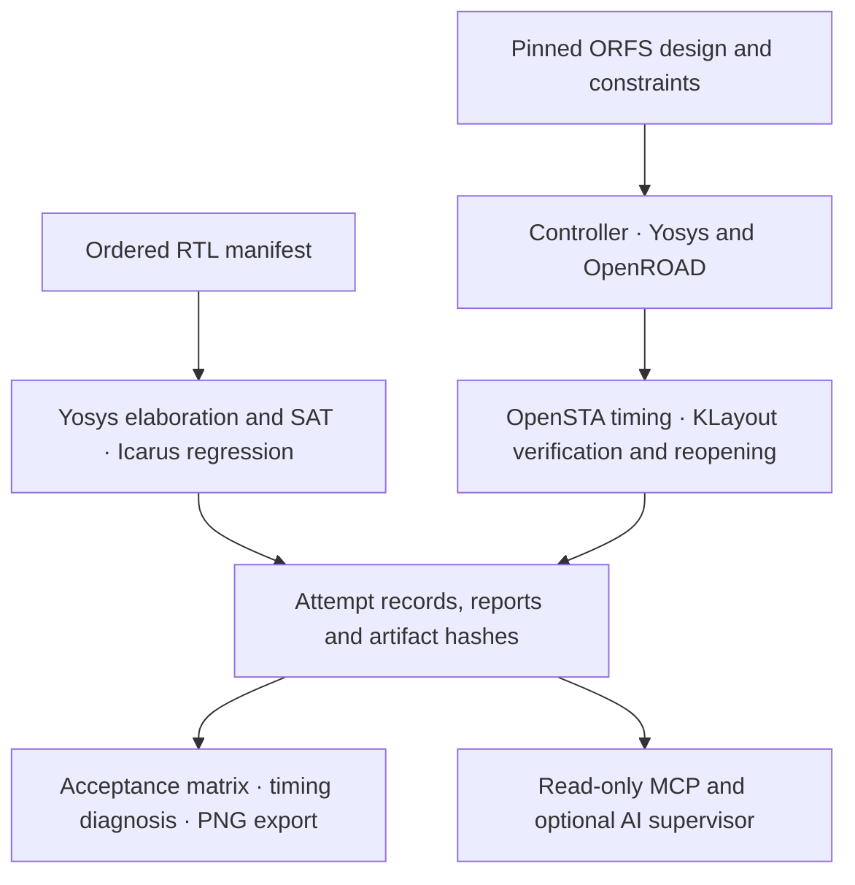

# AUTONOMOUS-EDA

AUTONOMOUS-EDA is a Python controller for reproducible RTL-to-GDSII experiments with OpenROAD Flow Scripts (ORFS). It records tool inputs, stage attempts, artifact hashes and verification outcomes. The controller can resume from verified checkpoints, compare compatible runs and expose bounded evidence to an optional read-only AI supervisor.

- [How the flow works](#how-the-flow-works)
- [Engineering capabilities](#engineering-capabilities)
- [Installation and quickstart](#installation-and-quickstart)
- [Run and inspect GCD](#run-and-inspect-gcd)
- [Diagnosis and AI assistance](#diagnosis-and-ai-assistance)
- [Examples and measured results](#examples-and-measured-results)
- [Architecture and development](#architecture-and-development)

## How the flow works

Use the RTL workflow to check an explicitly declared source set and testbench. Use the pinned ORFS workflow to run a supported physical design. Verification evaluates independent gates against recorded evidence. The optional supervisor can help interpret supported observations and suggest follow-up measurements. [Evidence contract](docs/EVIDENCE_CONTRACT.md) · [Verification profiles](docs/VERIFICATION_AND_ACCEPTANCE.md)

## Engineering capabilities

| Capability | Status | Evidence or scope |
| --- | --- | --- |
| RTL elaboration and functional regression | Implemented | Yosys hierarchy and Icarus regression with an explicit testbench and oracle |
| Hierarchical design ingestion | Implemented | Ordered FuseSoC synthesis export and sv2v/Yosys elaboration verified on [pinned OpenTitan AES](docs/tutorials/OPENTITAN_AES.md) |
| Macro and partition readiness | Partially validated | [Earl Grey source inventory and DFFRAM view checks](docs/OPENTITAN_READINESS.md) |
| Formal checks | Partially validated | Exact-port combinational two-state SAT with a real mismatch and correction |
| Synthesis, floorplan, placement, clock-tree synthesis (CTS), global and detailed routing | Implemented | Pinned ORFS checkpoints for Sky130HD GCD and Ibex |
| Static timing analysis (STA) | Implemented | Setup and hold evaluated independently. Both reference designs fail setup at their original clocks. |
| Timing constraint coverage | Partially validated | Pinned OpenSTA probe on eligible controller checkpoints. The historical indexes lack the required recorded inputs. |
| GDSII generation and independent reopening | Implemented | Core GCD and Ibex layouts reopened in KLayout |
| Design rule checking (DRC) and layout versus schematic (LVS) | Implemented | Independent pinned platform checks for the retained core layouts |
| IO pad-ring placement | Experimental | Real Sky130 IO abstracts placed with ICeWall |
| Full-chip connectivity and signoff | Blocked | Qualified pad geometry, electrical views and chip-level evidence are required |
| Reporting and AI assistance | Implemented | Deterministic reports, comparisons, verified PNGs and optional bounded model interpretation |
| Studio 2.0 | Implemented | [Physical checkpoints, timing paths, verification and execution](docs/PHYSICAL_WORKSPACE.md) verified on recorded GCD and AES evidence |

[Measured verification](docs/VERIFICATION_EVALUATION.md) · [IO evaluation](docs/IO_PAD_RING_EVALUATION.md) · [Roadmap](docs/ROADMAP.md)

## Installation and quickstart

Run these commands from the repository root with Python 3.11 or newer. The base package supports planning and reading existing evidence on Linux and Windows. Install Yosys on the host running RTL inspection. The RTL verification fixture also requires Icarus Verilog and `vvp`. Run physical implementation and KLayout PNG capture on Linux or inside WSL2 Ubuntu with Docker and the pinned Linux/amd64 ORFS image. The image supplies Sky130HD platform views. [Environment Doctor](docs/ENVIRONMENT_DOCTOR.md)

~~~sh
git clone https://github.com/wellitsabhinav/AUTONOMOUS-EDA.git
cd AUTONOMOUS-EDA
python -m pip install -e .
autonomous-eda doctor
autonomous-eda inspect examples/counter.toml
autonomous-eda plan configs/gcd-sky130hd.toml
~~~

The counter inspection reads the ordered files from its [RTL manifest](examples/counter.toml). A Windows Yosys run returned this excerpt from its JSON.

~~~json
"count": {
  "direction": "output",
  "width": 8
}
~~~

The [verification fixture](examples/verification/manifest.toml) is an independent combinational example with a testbench and a reference design. Use a fresh experiment directory. In PowerShell, use `Copy-Item -Recurse` for the copy.

~~~sh
mkdir -p experiments
cp -R examples/verification experiments/logic-verification
autonomous-eda verify experiments/logic-verification --profile rtl-formal --markdown
~~~

On Linux, the fixture returned this acceptance excerpt after Yosys elaboration and SAT and Icarus regression.

~~~text
| elaboration | required | PASSED | Yosys elaboration and structural check completed (7 evidence references) |
| functional_regression | required | PASSED | Regression oracle emitted LOGIC_PASS (10 evidence references) |
| equivalence | required | PASSED | SAT proved all matching outputs for defined two-state inputs (14 evidence references) |
~~~

The [verification evaluation](docs/VERIFICATION_EVALUATION.md) records the Icarus oracle failure and SAT counterexample when the candidate's XOR becomes OR, and the pass after restoring XOR. See the [CLI reference](docs/CLI_REFERENCE.md) for entry points and help.

## Run and inspect GCD

Use the [GCD walkthrough](docs/tutorials/GCD_WALKTHROUGH.md) for the pinned image, implementation commands, stage checkpoints, real output and timing interpretation. The `run` command evaluates implementation completion. A profiled `verify` returns exit code 1 when an acceptance gate fails or is blocked. Use `report` to read the matrix and `resume` to reuse valid checkpoints.

Export the recorded stage checkpoints, then open the [Physical Design Explorer and Execution Console](docs/PHYSICAL_WORKSPACE.md).

~~~sh
autonomous-eda artifacts snapshots experiments/gcd-walkthrough experiments/gcd-snapshots
autonomous-eda artifacts workspace experiments/gcd-snapshots --run experiments/gcd-walkthrough
~~~

*Historical GCD final GDSII rendered by KLayout. This is the recorded core layout from the gallery.* [Run and figure provenance](docs/EXAMPLE_GALLERY.md#physical-implementation)

## Diagnosis and AI assistance

Use `diagnose RUN --check setup` to read supported timing observations and their report locations. A negative worst slack establishes a timing violation. Identifying its cause requires path-local evidence, such as cell and net delay observations, clock insertion and comparable endpoints.

The optional `ai` workflow reads an explicit experiment allowlist and records evidence collection, inference and replay in its own journal. Observe mode requires no model. Explain mode uses a configured provider and validates the model's selections against deterministic findings. A local provider supports offline operation once its model and runtime are available. [Timing diagnosis](docs/TIMING_DIAGNOSIS.md) · [AI supervisor](docs/AI_SUPERVISOR.md) · [Observed AI runs](docs/DIAGNOSIS_EVALUATION.md)

The [GCD walkthrough](docs/tutorials/GCD_WALKTHROUGH.md#read-the-same-run-with-the-ai-supervisor) shows how to configure a local evidence registry and replay a recorded observation.

The [log diagnostics walkthrough](docs/PHYSICAL_WORKSPACE.md#diagnose-the-retained-openroad-failure) classifies the preserved OpenROAD teardown crash and shows how to review the proposed correction.

## Examples and measured results

| Design | Original clock (ns) | Final setup worst slack (ns) | Measured outcome |
| --- | ---: | ---: | --- |
| GCD | 1.1 | −1.20488 | Hold, platform DRC, LVS and GDS reopening passed |
| Ibex | 8.0 | −0.377013 | Hold, platform DRC, LVS and GDS reopening passed |
| GCD optimization candidates | 1.1 | See evaluation | Four completed candidates, zero setup-feasible candidates |
| ICeWall pad placement example | — | — | Four pads, four corners and 156 continuity cells. Chip-level acceptance blocked. |

[Source indexes and images](docs/EXAMPLE_GALLERY.md) · [Optimization evaluation](docs/OPTIMIZATION_EVALUATION.md) · [IO walkthrough](docs/IO_PAD_RING.md)

## Architecture and development

| Topic | Guide |
| --- | --- |
| Controller, tool adapters and run evidence | [Architecture](docs/ARCHITECTURE.md) · [Evidence contract](docs/EVIDENCE_CONTRACT.md) |
| Experiments and recovery | [Experiment protocol](docs/EXPERIMENT_PROTOCOL.md) · [Optimization](docs/OPTIMIZATION.md) |
| Timing, verification and debugging | [Physical diagnosis](docs/PHYSICAL_DIAGNOSIS.md) · [Verification profiles](docs/VERIFICATION_AND_ACCEPTANCE.md) |
| Read-only evidence and model integration | [MCP](docs/MCP.md) · [Offline knowledge](docs/KNOWLEDGE.md) · [Model gateway](docs/MODEL_GATEWAY.md) |
| Development and validation | [Contributing](CONTRIBUTING.md) · [Documentation design system](docs/DESIGN_SYSTEM.md) · [Project state](docs/PROJECT_STATE.md) · [Roadmap](docs/ROADMAP.md) |
