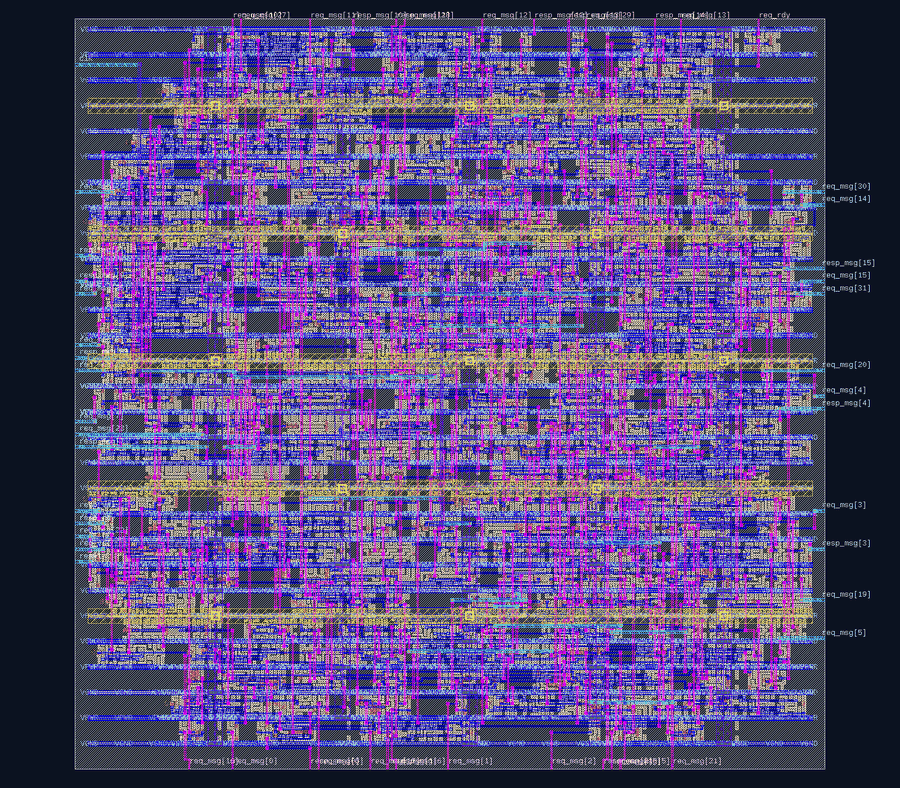
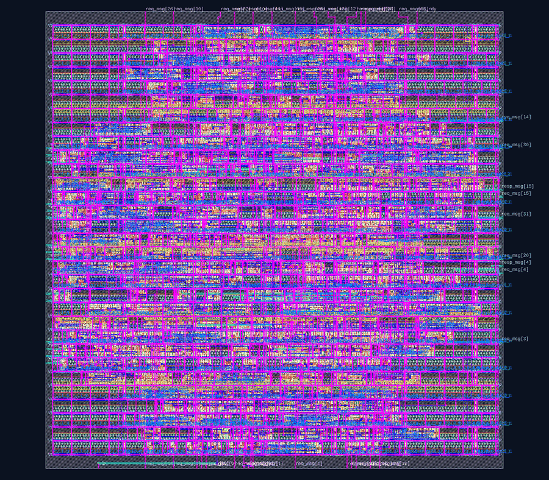

# Example results gallery

These figures come from retained GCD and Ibex Sky130HD artifacts and four new GCD implementations. All timing figures use the recorded `tt_025C_1v80` corner. KLayout 0.30.12 rendered the GDS views with the pinned Sky130HD layer map. The gallery publishes reduced-size copies. Full-resolution PNGs and manifests stay with the run.

## GCD at 1.1 ns

Retained run `fadc5e06093b`. Final setup worst slack was −1.20488 ns. Hold, platform DRC and LVS passed. The source GDS is identified by the [GCD reference index](evidence/gcd-sky130hd-index.json).

*GCD final GDS hierarchy at the recorded 80.025 µm × 80.025 µm extent. The image displays physical geometry.*

*GCD placement from transformed Sky130HD standard-cell GDS bounding boxes. Fill, decap and tap instances are omitted. Bounding boxes can overlap where cell geometry extends beyond the nominal placement site.*

*The retained GCD GDS with routing layer numbers 67–72 selected. The [central detail](images/examples/gcd/layout_detail.png) enlarges the same layers at the layout center.*

*GCD final aggregate setup slack and the corresponding printed OpenSTA path. The path table uses rounded values.* [Independent verification gates](images/examples/gcd/verification_summary.png) · [PNG provenance](images/examples/gcd/provenance.json)

## Retained Ibex at 8 ns

Retained run `820d1810648f`. The original archive reports −0.377013 ns setup slack. Hold, DRC and LVS passed. [Ibex reference index](evidence/ibex-sky130hd-index.json)

*Ibex final GDS overview of the historical implementation.*

*Stage worst negative slack from verified ORFS JSON reports. The global-route and final setup extrema launch from different instruction bits.* [Critical path accounting](images/examples/ibex/critical_path_breakdown.png) · [Verification gates](images/examples/ibex/verification_summary.png) · [PNG provenance](images/examples/ibex/provenance.json)

## GCD optimization campaign

Campaign `3563e8e28ec145239fc5f6f1a0ab9f69`. Four candidates completed, and all missed the original 1.1 ns setup constraint. The feasible frontier is empty. [Measured results and model usage](OPTIMIZATION_EVALUATION.md)

*Recorded standard-cell area and setup slack for the retained baseline and four comparable candidates. Every point is below zero slack.*

*Flow completion and physical feasibility from the campaign report. Full acceptance also depends on additional verification gates.* [Candidate measurements](images/examples/optimization/optimization_summary.png) · [Search history](images/examples/optimization/search_history.png) · [Budget](images/examples/optimization/budget_usage.png) · [Grid and guided comparison](images/examples/optimization/strategy_comparison.png)

*Candidate run `599c45ae7f4c` used 30% core utilization. Its GDS extent was 89.815 µm × 89.815 µm, compared with the baseline’s 80.025 µm × 80.025 µm. Each preview is fitted to its own extent.* [PNG provenance](images/examples/optimization/provenance.json)

## Regenerate

~~~sh
python -m pip install -e '.[visuals]'
autonomous-eda artifacts render .local/diagnosis-reference/gcd --all
autonomous-eda artifacts render .local/diagnosis-reference/ibex --all
autonomous-eda artifacts render experiments/optimization-gcd-m8 --all
autonomous-eda artifacts gallery experiments/optimization-gcd-m8
~~~

Use Linux or WSL2 with the cached image for the KLayout views. Report-only rendering works with Matplotlib Agg on Windows or Linux. The campaign renderer writes `report.json`, `report.md`, and `visualizations/visualization_manifest.json`. Clock-net identification and a location-qualified critical-region crop require additional evidence. The gallery's detail is a geometric center crop.
