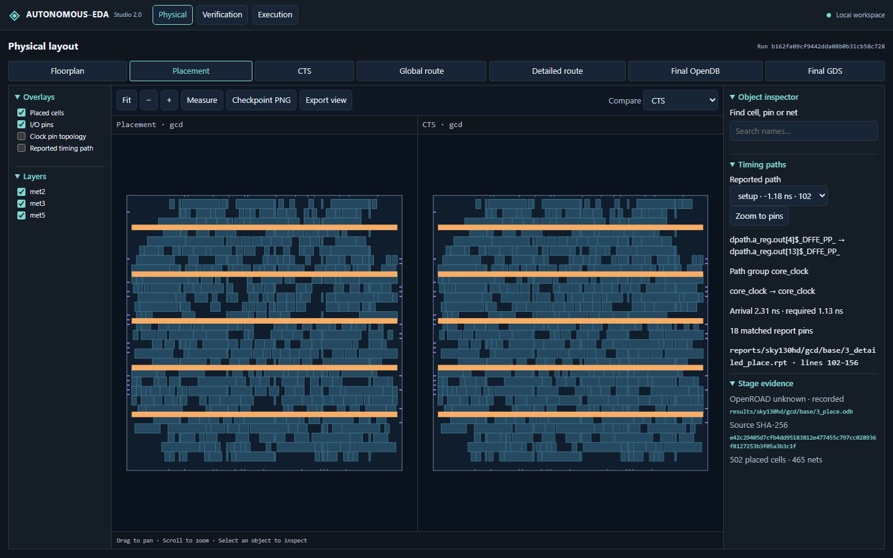
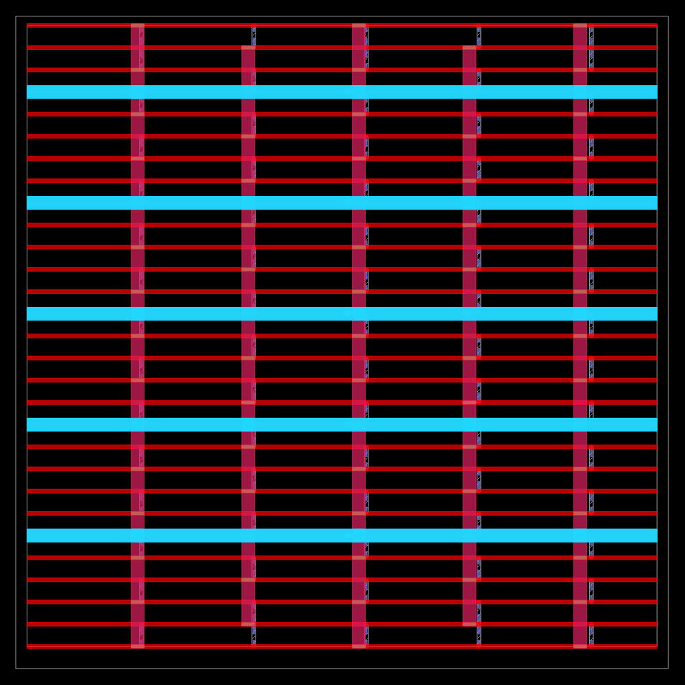
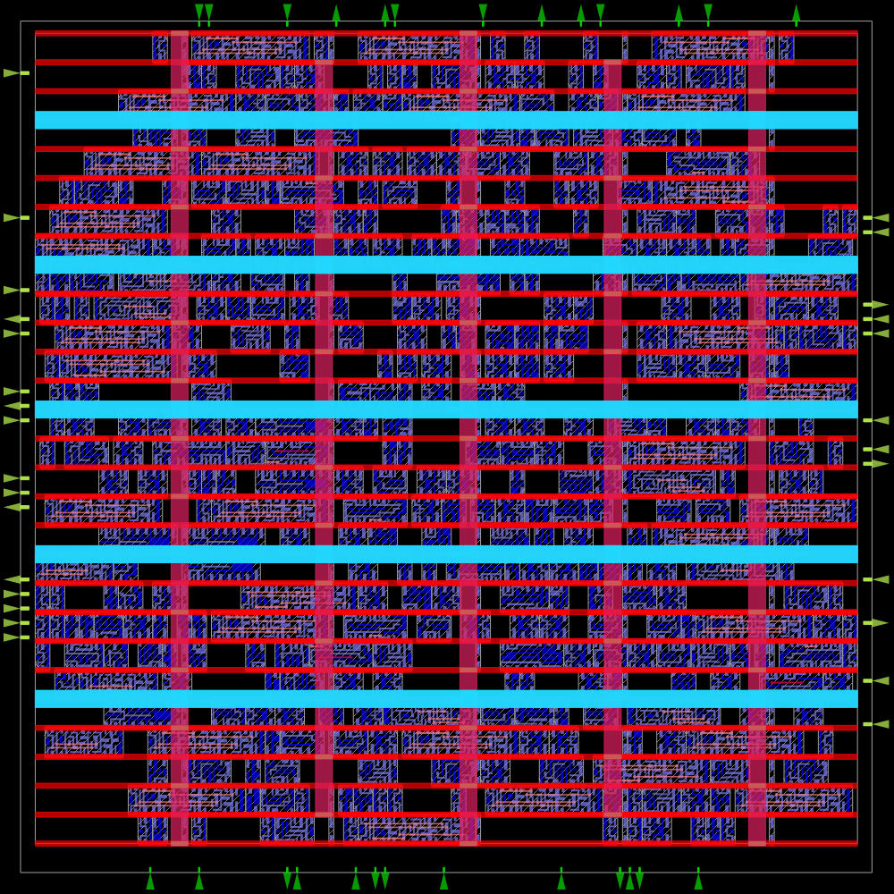
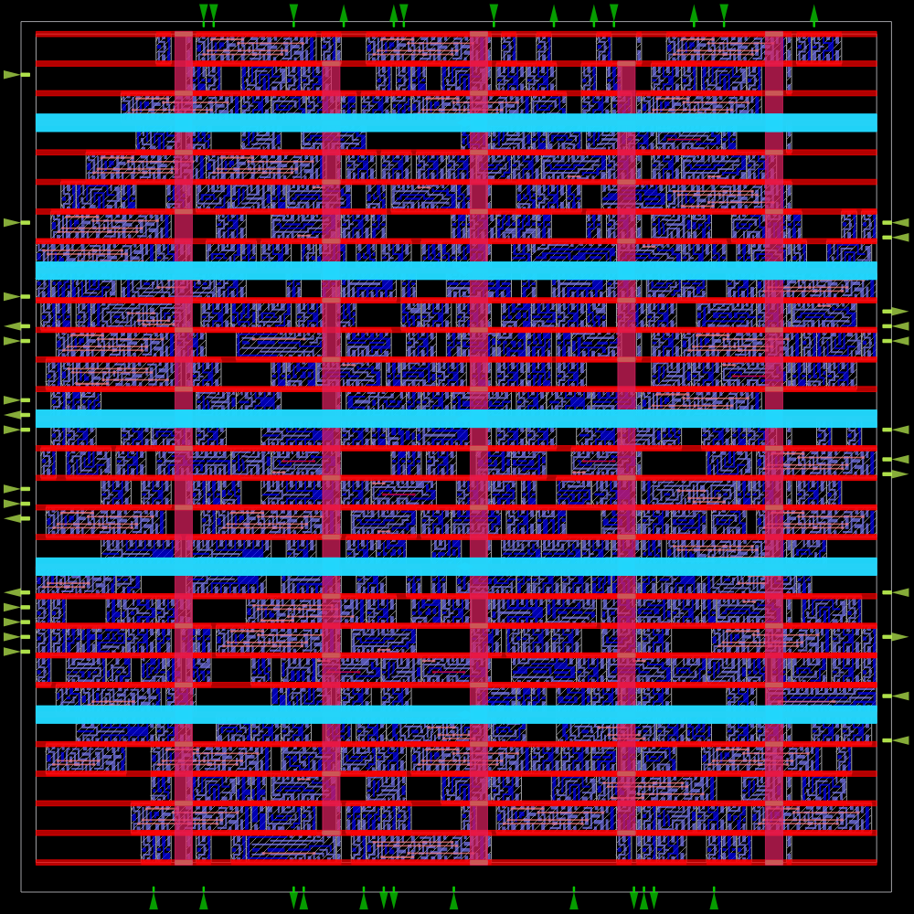

# AUTONOMOUS-EDA Studio 2.0

Studio 2.0 opens retained physical checkpoints in a local browser with stage comparison, object inspection, timing paths, verification and a readout of recorded execution. Rendering uses the pinned ORFS image on Linux or WSL2. Once a bundle exists, the viewer runs with base Python on Windows or Linux. Follow the [GCD walkthrough](tutorials/GCD_WALKTHROUGH.md) for environment setup and run commands.

[Workspace overview](images/studio/gcd-placement.png) · [Cell inspection](images/studio/gcd-inspection.png) · [Timing pins](images/studio/gcd-timing.png) · [Verification](images/studio/gcd-verification.png) · [Execution](images/studio/gcd-execution.png) · [AES placement](images/studio/aes-placement.png) · [AES routing failure](images/studio/aes-diagnostic.png) · [Screenshot provenance](images/studio/provenance.json)

## Export and open GCD

~~~sh
autonomous-eda artifacts snapshots experiments/gcd-walkthrough experiments/gcd-snapshots
autonomous-eda artifacts workspace experiments/gcd-snapshots --run experiments/gcd-walkthrough --journal .local/manual-ai.sqlite3
~~~

Open the loopback URL printed by the second command. Omit the journal argument if you skipped the AI walkthrough. Give each export a fresh destination outside its input root. The command returns 1 if a stage is absent, modified, superseded or fails to render, and saves the outcomes for every selected stage in the bundle. Stop the server with Ctrl+C.

| Backend | Input | Available inspection |
| --- | --- | --- |
| OpenROAD | OpenDB checkpoint | Placed instance rectangles and masters, pad instances, port boxes, net connectivity, clock pins, routed metal rectangles, route guides and GCell records when present |
| OpenROAD | DEF with ordered technology and cell LEFs | Layout geometry and connectivity carried by the DEF and LEFs |
| KLayout | GDSII | Hierarchical polygon, box and path geometry by GDS layer and datatype. Large layouts have a 300,000-polygon vector preview limit. |

Each PNG carries JSON in the PNG text field **autonomous-eda.provenance**, including source path, run, stage, SHA-256, tool banner, pinned image digest and generation command. The bundle records PNG and geometry hashes and retains tool logs. OpenROAD in the pinned image reports its version as **OpenROAD unknown**. The image digest identifies the build. KLayout reports **0.30.12**. [OpenROAD image and area options](https://openroad.readthedocs.io/en/latest/main/src/gui/README.html) · [OpenDB geometry](https://openroad.readthedocs.io/en/latest/main/src/odb/README.html)

The viewer starts at placement. Use the stage timeline to select CTS, then turn on **Clock pin topology**. Clock lines join the sole recorded driver to placed sink pins. Highlighted clock buffer and inverter masters also connect to a recorded CLOCK net. Choose **Global route** in **Compare** to inspect both stages with a shared viewport. Select a cell, port or routed shape, or search its name. **Checkpoint PNG** exports the exact renderer output. **Export view** exports the current primary canvas with the viewport and display settings embedded in its provenance.

The **Route guides** display shows guide rectangles. **GCell usage / capacity** shows retained routing grid measurements. **Routed wire shapes** shows layer-resolved signal wire rectangles, with vias and special wires outside this vector overlay. The OpenROAD PNG and final GDS provide additional physical geometry. The timing overlay joins matched pin locations in a verified stage OpenSTA report and breaks at unresolved anchors. It uses the printed path slack. The GCD final setup metric remains −1.20488 ns.

In **Timing paths**, select a reported setup or hold path, read its endpoint, clock, slack and source details, and choose **Zoom to pins** when at least two pins match. Older bundles show the timing fields they recorded. Use **Measure** to place two points and read their separation in micrometres. Overlay, layer and inspector sections can collapse separately.

**Verification** displays the physical profile's independently recorded checks and their evidence references. Until an acceptance profile has run, it shows **NOT CHECKED** and the available controller gates. The browser keeps at most three stage models in its cache and the local server caps each canvas asset at 64 MiB. The checkpoint PNG remains the native raster evidence where the geometry preview reaches its limit.

## Additional inputs

For a standalone DEF, select run-relative paths. Supply the technology LEF first and then the matching cell LEFs. An explicit checkpoint receives operator-selected provenance and hashes of the source and LEFs.

~~~sh
autonomous-eda artifacts snapshots .local/def-inputs experiments/def-preview --checkpoint finish-def gcd.def --run-id gcd-def --top gcd --lef sky130_fd_sc_hd.tlef --lef sky130_fd_sc_hd_merged.lef
~~~

The [retained Ibex archive](EXAMPLE_GALLERY.md#ibex-at-8-ns) rendered its hash-indexed final GDS. The six OpenDB stages were absent from that archive inventory and are listed as missing. The exporter returned 1 with a usable GDS entry. To build a fresh pinned reference, run the [Ibex manifest](../configs/ibex-sky130hd.toml) and export its stage bundle.

~~~sh
autonomous-eda plan configs/ibex-sky130hd.toml
autonomous-eda run configs/ibex-sky130hd.toml experiments/ibex-workspace
autonomous-eda artifacts snapshots experiments/ibex-workspace experiments/ibex-snapshots
~~~

For the [ICeWall placement example](IO_PAD_RING.md), use the current attempt from **io-latest.json** in both the run ID and checkpoint path. Search for a pad, corner or spacer and inspect its master and connected nets. The retained placement example has four pads, four corners and 156 spacers. Patch 09C full-chip power and signoff are tracked in [issue #24](https://github.com/wellitsabhinav/AUTONOMOUS-EDA/issues/24).

~~~sh
autonomous-eda artifacts snapshots experiments/icewall experiments/icewall-snapshots --checkpoint pad-ring io-attempts/ATTEMPT_ID/placement.odb --run-id ATTEMPT_ID --top io_demo
autonomous-eda artifacts workspace experiments/icewall-snapshots
~~~

## Execution console

The console checks the selected Git checkout, detects host tools on PATH, reads renderer versions from the bundle and rehashes indexed assets. It polls the selected controller database and AI journal every two seconds while visible. Controller rows report recorded state, runtime, exit code and artifact references. Expand an attempt for its retained log and classified messages. Supervisor activity comes from the journal’s transitions and active leases. A recorded running attempt is labeled accordingly. The console observes existing CLI execution.

**Recorded events** exposes the latest 100 versioned controller attempts and supervisor transitions with recorded time, source, severity and stage. Controller events carry the run and attempt IDs. Supervisor transitions carry their workflow identity. Expand an attempt to see its redacted command and bounded native log.

## Diagnose the retained OpenROAD failure

The [original Tcl probe](evidence/physical-snapshots/teardown-probe.tcl) loaded the floorplan checkpoint, then tried to destroy and recreate the chip and block before loading placement. The [original log](evidence/physical-snapshots/openroad-teardown.log) stops with **Signal 11 received** after the floorplan inventory. The local workaround starts one process and one temporary work directory per stage. An unsuccessful process retains its log. A crash regression verifies that any PNG produced by that process is excluded and subsequent checkpoints can still publish.

~~~sh
autonomous-eda artifacts triage docs/evidence/physical-snapshots --log floorplan openroad-teardown.log --tool OpenROAD --output experiments/teardown-diagnostic
~~~

The bundle includes the **OPENROAD_PROCESS_SIGNAL** code, line 8, the exact message, its log-prefix hash, a bounded hypothesis and a diagnostic command. The classifier also recognizes selected Yosys, OpenSTA, ICeWall, KLayout, Icarus and verification signatures. Unsupported messages keep their cited excerpt and an unclassified code. Multiple matching stages correlate by signature.

Review the proposed correction and use its exact **approval_digest** to record approval for manual execution. Then run the proposed command or repeat the export in a new directory. The diagnostic bundle and approval preserve the observed log and correction independently of acceptance.

~~~sh
autonomous-eda artifacts triage-approve experiments/teardown-diagnostic --digest APPROVAL_DIGEST
~~~

Optional **--local-model** and **--local-endpoint** use a configured loopback Chat Completions model. The model can prioritize existing findings by ID. The classifier rejects unsupported IDs and retains the deterministic findings. See [model gateway](MODEL_GATEWAY.md) for local runtime setup.

### Review and replay an isolated renderer action

Prepare an exact plan for one recorded OpenDB checkpoint. The plan binds the diagnostic receipt, full crash-log hash, run, stage, attempt, checkpoint hash, PNG width and fresh output directory. Review the plan before entering its digest. Use `--decision reject` to retain a rejection. A changed input invalidates the approval. Verification rechecks the exact checkpoint and both rendered output hashes.

~~~sh
autonomous-eda artifacts correction plan experiments/teardown-diagnostic \
  docs/evidence/physical-snapshots experiments/gcd-walkthrough \
  experiments/teardown-review experiments/gcd-corrected-floorplan --stage floorplan --width 750
autonomous-eda artifacts correction review experiments/teardown-review \
  --digest PLAN_SHA256 --decision approve
autonomous-eda artifacts correction execute experiments/teardown-review --digest PLAN_SHA256
autonomous-eda artifacts workspace experiments/gcd-snapshots --run experiments/gcd-walkthrough \
  --correction experiments/teardown-review
~~~

The controlled integration run rejected one plan before dispatch and verified a separately approved floorplan render with pinned OpenROAD. Studio displayed the observed, diagnosed, proposed, reviewed, approved, executed and verified states from the saved receipts. [Correction receipt](evidence/integration/verified-correction.json) · [Studio correction screen](images/studio/gcd-correction.png)

## Measured GCD export

Run **b162fa09cf9442dda08b0b31cb58c728** rendered seven checkpoints at 1,000 px wide. Placement contains 502 placed cells. CTS contains 521 placed cells and six clock nets. The global-route checkpoint exposes 2,867 guide rectangles and 500 GCell records. The final GDS provides 56,243 polygons. The published PNGs and their [provenance](images/gcd-stage-snapshots/provenance.json) bind to the original [run receipt](evidence/gcd-walkthrough/receipt.json).

| Floorplan | Placement | CTS |
| --- | --- | --- |
|  |  |  |
| [Global route](images/gcd-stage-snapshots/grt.png) | [Detailed route](images/gcd-stage-snapshots/route.png) | [Final OpenDB](images/gcd-stage-snapshots/finish.png) · [Final GDS](images/gcd-stage-snapshots/gds.png) |

## Browser validation

Headless Edge 157 on a Ryzen 7 7735HS loaded the 502-cell GCD placement in 381 ms and switched to its final OpenDB in 75 ms, measured from navigation or click to the reported stage label. The 51.7 MB AES placement geometry loaded in 1.74 s and switched to the 52.2 MB CTS geometry in 1.27 s. Sampled live page JS heap after comparison was 16.9 MB for GCD and 221.6 MB for AES. These are single local measurements. Both sessions exercised stage switching, comparison, measurement, verification and recorded execution. The GCD session also verified a selected object, anchored timing pins and the embedded provenance of the canvas PNG. [Browser receipts and screenshot hashes](images/studio/provenance.json)

To replay the checks, start the workspace at its printed loopback URL. Start a dedicated headless Chromium or Edge session with `--remote-debugging-port=9227` and a fresh `--user-data-dir`, then run the [browser smoke test](../tests/studio_browser.mjs) with Node.js 24.

~~~sh
node tests/studio_browser.mjs http://127.0.0.1:8765/ experiments/studio-browser-smoke
node tests/studio_browser.mjs http://127.0.0.1:8765/ experiments/studio-browser-aes aes
~~~
