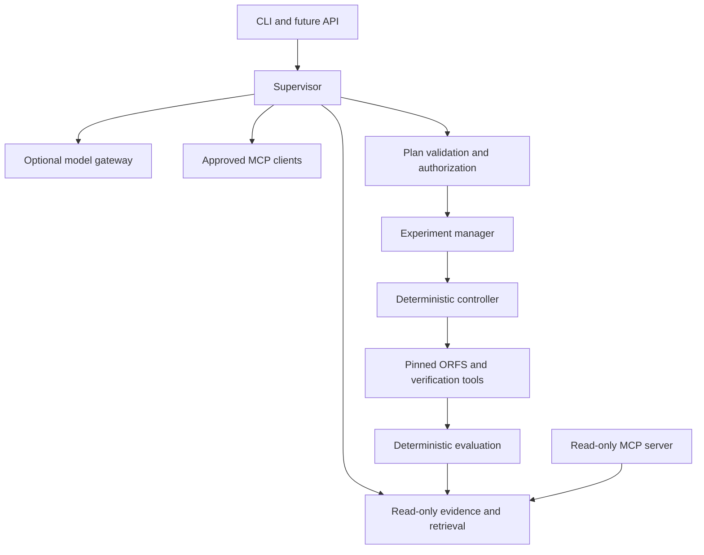

# AI system architecture

Proposed target and local baseline audit as of 2026-11-13. This design extends the [deterministic architecture](../ARCHITECTURE.md) and [experiment protocol](../EXPERIMENT_PROTOCOL.md). The implementation choices are recorded in [ADR 0001](../adr/0001-ai-system-foundations.md).

## Baseline and reuse

Bootstrap merged into `main` at `6a43937` with Python packaging, the `autonomous-eda` entry point, and lightweight CI. The [Environment Doctor](../ENVIRONMENT_DOCTOR.md) builds on the inventory and tool discovery approach at local prototype commit `b3d3d69`. It distinguishes host and container evidence and adds offline engine, image and workspace checks. [Bootstrap PR](https://github.com/wellitsabhinav/AUTONOMOUS-EDA/pull/2)

The later local snapshot at `9e79f44` already implements the following controller pieces. Review and promote those pieces in dependency order.

| Existing code | Reuse and extension |
| --- | --- |
| `cli.py`, `doctor.py` | Keep the CLI entry point and existing version/exit conventions. Add structured doctor checks and optional command groups as their milestones land. |
| `manifest.py`, `discovery.py` | Keep typed manifests, ordered file lists, and Yosys elaboration. Add native source resolution and versioned constraint evidence as design support grows. |
| `orfs.py`, `experiment.py` | Keep pinned adapter commands, stage dependencies, isolated runs, SQLite attempts, and hash-validated checkpoint recovery. Add versioned provenance and a durable run identity. |
| `metrics.py`, `diagnosis.py` | Keep deterministic metrics and gate evaluation. Add typed artifact citations, timing-path records, and stage-specific diagnoses. |
| `optimization.py` | Keep the bounded GCD utilization sweep and feasibility filtering as a comparison baseline. Extend comparison to explicitly matched inputs, operating corner, and gate configuration. |

Local validation on Python 3.12.5 passed Ruff lint, Ruff formatting, mypy, and pytest on both `bf977ed` (1 test) and an isolated archive of `9e79f44` (16 tests). The later tests cover manifests, stage/checkpoint behavior, independent gates, deterministic diagnosis, and candidate rejection. The physical evidence audit below reused stored artifacts. This audit did not run implementation tools.

## Component boundaries

An experiment record identifies the design, platform and operating corners, controller commit, ordered input and config hashes, upstream revision, image digest and tool versions, resource limits, stage attempts, and artifact hashes. Every metric carries units, a stage and corner when applicable, and a reference to the source artifact. A reference carries a run or document ID, digest, and a report location such as a line range or JSON key. Legacy records remain readable and expose missing provenance as unknown. Stale or absent artifacts cannot satisfy required gates.

Record execution completion, GDS production, and independent GDS reopening as distinct outcomes. Evaluate setup, hold, DRC, LVS, timing coverage, RTL regression, equivalence, connectivity, and other configured checks independently using `passed`, `failed`, `blocked`, or `not checked`. Evaluate PPA objectives against measured values. A configured acceptance result requires every applicable hard gate and objective to pass. Record router rule checks and platform-deck DRC independently. The evaluator derives these states from immutable references and tool outputs.

## Supervisor and controlled execution

Use a typed state machine. Persist input identity, transition version, evidence references, proposal digest, approval, budget debits, attempt ID, and terminal reason in SQLite. Record model or external-tool responses when they influence a decision, subject to the data policy. Replay consumes recorded decisions and evidence, validates transition preconditions, and reconciles controller state before dispatch. Give each dispatch a durable idempotency key to recover a committed intent after interruption. Retry only bounded transient failures and use the existing stage recovery path for known run attempts.

| Mode | Behavior |
| --- | --- |
| Observe | Inspect existing evidence and emit observations, hypotheses, and gaps. |
| Suggest | Emit a typed plan and policy verdict for review. |
| Execute | Dispatch a validated plan with authorization bound to its digest, input revision, and budget. |
| Optimize | Use the same validation per candidate within an authorized action set, proposal count, and aggregate budget. |

A plan records its objective, baseline, design/platform, immutable inputs, target metrics, and typed parameter edits. It contains a rationale and evidence, expected effects marked as predictions, risks, CPU/memory/time limits, approval scope, verification requirements, rollback procedure, and explicit success and stop criteria. Validate ORFS variable support against the pinned backend and enforce legal combinations and bounds. Protect baseline RTL, clocks, constraints, and artifacts. RTL changes require explicit authorization and applicable equivalence evidence. A change to protected inputs or plan parameters invalidates prior approval.

Stop when the candidate or time budget is consumed, proposals repeat, minimum improvement is missed for the configured interval, required evidence is unavailable, the configured search is exhausted, or the supervisor needs a human decision. Store all attempts and compare like-for-like runs using deterministic grid or seeded random search first. Rank only feasible runs on measured area, delay, and power where available. Higher setup slack or lower area alone is insufficient for acceptance.

| Capability | Typed result |
| --- | --- |
| Supervisor | Transition, resource debit, next action or terminal reason |
| RTL analysis | Hierarchy, ordered sources, clocks, resets, memory inference, and elaboration gaps |
| Constraints | Clock and I/O intent, exceptions, corner coverage, and evidence for proposed corrections |
| Physical design | Stage observations and permissible floorplan, placement, CTS, or routing proposals |
| STA diagnosis | Path/group observations, mechanisms and alternatives, uncertainty, and requested measurements |
| Verification | Individual check results and references bound to the inspected artifacts |
| PPA optimization | Candidate plan, measured comparisons, feasibility, and frontier membership |
| Knowledge | Ranked, budgeted and cited evidence with source trust metadata |
| Evaluation | Independently derived acceptance decision and unresolved criteria |

Implement each capability as a typed call over explicit inputs. Route metrics parsing, classification where rules suffice, and verification through deterministic code. Use a model only where synthesis of evidence or proposal reasoning warrants it. Its outputs are hypotheses or proposals and pass the same schema and policy checks as any other input.

## Knowledge, providers, and MCP

An explicitly approved source list covers pinned ORFS, OpenROAD and OpenSTA documentation/help, design constraints and configs, stage logs and reports, and prior experiment evidence. Resolve approved paths within configured roots and index immutable revisions or content hashes. Parse timing paths and path groups, log errors and surrounding stage context, and document sections before embedding. Store citations with line/page ranges, tool version, design, platform, run, stage, corner, extraction time, and trust classification where available.

Use SQLite FTS5 BM25 and a versioned local vector index for the first corpus. Fuse ranked results and assemble a context within its token budget. Support deduplication, stale-document detection, reindexing, deletion, and offline search. An evaluation fixture records relevant evidence and abstention cases. Compare Recall@k, MRR, citation correctness, answer faithfulness, abstention, and latency against keyword-only retrieval before adding reranking. Keep authoritative runs, the rebuildable knowledge index, and intervention summaries with observed outcomes. Preserve negative results and label predictions.

The provider interface accepts a task, explicit evidence, an output schema, and request limits. Its adapters implement local endpoint inference, a deterministic mock, and an opt-in hosted provider. Validate structured output locally, enforce token/time/cost budgets and redaction, and keep credentials in the adapter environment. Hosted transfers require consent for the actual data and destination. A provider failure can stop or retry reasoning within budget while the controller continues to own physical execution and checkpoints.

Use the official Python MCP SDK over local stdio. Start with read-only capabilities for approved design/run IDs, timing summaries, and artifact references. Validate inputs and outputs, cap payloads, bound timeouts, emit structured errors, and audit actor, capability, and outcome. The host launches approved servers with fixed arguments and scoped environments. Treat external tool descriptions, document content, log lines, and responses as data. Remote transport requires separately reviewed identity, authorization, and resource controls. Future write capabilities must invoke the same canonical policy and experiment interfaces as the CLI. [MCP transport specification](https://modelcontextprotocol.io/specification/2026-07-28/basic/transports)

Use allowlisted actions and canonicalized paths at the execution boundary. Require a revalidated, approved plan before starting expensive work. Use argument vectors, resource-limited containers with restricted mounts and networking, separated inference and execution credentials, and audit logs that omit secrets. Test malformed inputs, unauthorized requests, path escapes, interruption, and instructions embedded in malicious fixtures. Repository operations use existing GitHub tools.

## Reference evidence audit

Read the local `6_final.sdc`, `6_report.json`, `6_finish.rpt`, DRC counts and LVS logs for the two baseline directories under `experiments/`. Recomputed GDS SHA-256 values match the local evidence summaries at `9e79f44`. The KLayout reopening logs record `gcd` with 74 cells and `ibex_core` with 222 cells. Both runs report positive worst hold slack with zero hold violations, a DRC report count of zero, and an LVS match. The GCD DRC/LVS status files reference the observed GDS hash. The upstream Ibex evidence consists of the reports and databases from the upstream run. RTL regression, equivalence, timing coverage, and standalone connectivity still require explicit evidence.

| Sky130HD baseline | Clock | Setup worst slack | Hold worst slack | Standard-cell area | Instances |
| --- | ---: | ---: | ---: | ---: | ---: |
| Controller GCD | 1.1 ns | −1.20488 ns | +0.429847 ns | 4,414.23 µm² | 930 |
| Upstream ORFS Ibex | 8.0 ns | −0.377013 ns | +0.426791 ns | 177,181 µm² | 40,197 |

The first six GCD checkpoint attempts in `experiments/controller-gcd/run.sqlite3` total 137.68 s. The GCD 30% and 46% utilization variants retained the 1.1 ns clock and reported setup worst slack of −1.17831 ns and −1.33046 ns, respectively. The existing `optimization.json` rejects both candidates and records an empty feasible frontier.

- **GCD.** The `core_clock` max path from `dpath.b_reg.out[2]` to `dpath.a_reg.out[10]` reports 2.35 ns arrival and 1.14 ns required time. Launch and capture clock network delays are approximately 0.29 and 0.28 ns. The displayed data section has a chain of logic and buffering arcs, with individual net increments rounded to 0.00 ns. This suggests cell delay and logic depth are the first measurements to refine; loading still affects cell delay. Floorplan worst slack was already −1.10564 ns. Use matched-path stage reports and higher precision extraction before assigning causality. (`experiments/controller-gcd/reports/sky130hd/gcd/base/6_finish.rpt`, lines 132–205.)
- **Ibex.** The `core_clock` max path from `if_stage_i.instr_rdata_id_o[20]` to `gen_regfile_ff.register_file_i.rf_reg[58]` reports 9.37 ns arrival and 8.99 ns required time. Rounded path values imply about 8.15 ns from launch clock pin to capture data pin and about 0.11 ns later launch insertion than capture insertion. Aggregate slack moved from −0.123554 ns after CTS to −0.238938 ns after global route and −0.377013 ns at finish. These stage extrema may come from different paths. Compare the same endpoints and corner with matched clocks and parasitics before attributing the regression to routing or selecting an intervention. (`experiments/upstream-ibex/reports/sky130hd/ibex/base/6_finish.rpt`, lines 395–594, and per-stage JSON.)

## Delivery and acceptance

The first executable slice is Environment Doctor. Its text and JSON reports distinguish PASS, WARN, FAIL, and UNKNOWN. The command runs bounded host and pinned-backend checks, with deterministic fixtures and an offline integration run. Its behavior and reproduction steps are in the [Environment Doctor guide](../ENVIRONMENT_DOCTOR.md).

Subsequent milestones publish the controller and provenance, demonstrate real read-only MCP discovery and invocation, compare offline hybrid retrieval with BM25, demonstrate durable and evidence-grounded supervisor diagnosis, and validate bounded optimization using measured feasible outcomes. Recovery checks interrupt and resume a real supported run checkpoint when the configured EDA environment is available. Prompt-injection tests assert that retrieved instructions cannot authorize operations. The [roadmap](../ROADMAP.md) tracks issue dependencies and the individual acceptance criteria.

Use a medium-complexity reference design before committing to OpenTitan-scale support. Resolve native build metadata, generated inputs, and clock/reset and hierarchy information at pinned revisions. Inventory available memory, macro, technology, power, and IO views. Demonstrate the supported implementation configuration and configured verification gates before claiming full-chip capability. APIs and dashboard views consume versioned results once those contracts stabilize.
