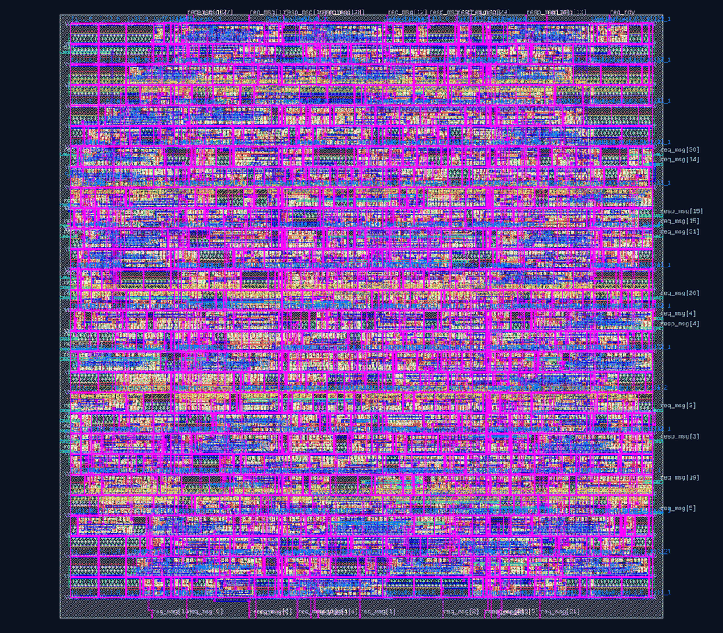

# GCD RTL-to-GDSII walkthrough

Run the pinned Sky130HD GCD design at its original 1.1 ns clock. The example records a completed physical implementation, then uses independent evidence to diagnose its failed setup check.

## Prepare the backend

Use a Linux or WSL2 Ubuntu shell with Docker, Python 3.11 or newer, and a writable checkout. From the repository root, install the controller and the image-rendering extra. If the pinned Linux/amd64 image is missing, pull it once. The controller uses the local image for offline execution.

~~~sh
python -m pip install -e '.[visuals]'
docker pull --platform linux/amd64 \
  openroad/orfs@sha256:8eff077230b86729f6248b34eeab370e486fa4052d34c60d9067e3e4aa720987
autonomous-eda doctor
~~~

The [manifest](../../configs/gcd-sky130hd.toml) selects the upstream `designs/sky130hd/gcd/config.mk` at ORFS revision `23341145f0fc92a522de26d5244a4a0013818f97`. That configuration selects the RTL files, platform abstracts and timing constraints. The manifest also records the top module, clock period, two tool threads and a 900-second timeout per stage. Use the separate [RTL quickstart](../../README.md#installation-and-quickstart) to exercise native Yosys and Icarus with an explicit testbench.

In the recorded walkthrough, Doctor used WSL2 Ubuntu 24.04.5, Python 3.12.3 and Docker 29.1.3. In the image it reported GNU Make 4.4.1, Yosys 0.68+post and KLayout 0.30.12. OpenROAD answered its probe with `unknown` for the version. Doctor verified the digest and architecture despite warnings about missing optional host tools and standalone OpenSTA. [Doctor checks and exit codes](../ENVIRONMENT_DOCTOR.md)

## Plan the implementation

~~~sh
autonomous-eda plan configs/gcd-sky130hd.toml
~~~

The first object in the captured JSON shows the synthesis outputs that the next stage depends on.

~~~json
{
  "name": "synth",
  "after": [],
  "outputs": [
    "results/sky130hd/gcd/base/1_synth.odb",
    "results/sky130hd/gcd/base/1_synth.sdc"
  ]
}
~~~

## Run and resume

Use a new directory for each experiment. The single `run` invocation dispatches all seven stages in order. Read `attempts` in the run JSON for the exact tool commands, attempt states, exit statuses and hashes. Use `resume` to reuse valid checkpoints or continue from the earliest invalid stage.

~~~sh
autonomous-eda run configs/gcd-sky130hd.toml experiments/gcd-walkthrough --memory-mib 1200
autonomous-eda resume experiments/gcd-walkthrough
~~~

Run `b162fa09cf9442dda08b0b31cb58c728` completed all seven stages in 145.208 s of recorded stage time. The captured `run` and `resume` JSON outputs had identical hashes. [Attempt records and source hashes](../evidence/gcd-walkthrough/receipt.json) · [Full stage plan](../evidence/gcd-walkthrough/plan.json)

Paths in the checkpoint column are relative to `results/sky130hd/gcd/base/` inside the experiment. OpenDB (`.odb`) stores the design database and Synopsys Design Constraints (`.sdc`) carries timing constraints.

| Stage | Tool and purpose | Main checkpoint | What to investigate if it fails |
| --- | --- | --- | --- |
| Synthesis | Yosys elaborates and maps the configured RTL to the Sky130HD library. ORFS hands the netlist to OpenROAD. | `1_synth.odb`, `1_synth.sdc` | Upstream source list, top name, mapping errors and Liberty |
| Floorplan | OpenROAD establishes die and core dimensions, placement rows and the power-distribution network. | `2_floorplan.odb`, `2_floorplan.sdc` | Die and row geometry, site or pin availability and power-grid errors |
| Placement | OpenROAD places pins and standard cells, then legalizes the cells to sites. | `3_place.odb`, `3_place.sdc` | Utilization, legal sites, overlap and placement constraints |
| Clock-tree synthesis | OpenROAD inserts clock buffers and builds clock distribution. OpenSTA analyzes timing with a propagated clock where configured. | `4_cts.odb`, `4_cts.sdc` | Clock definitions, sink coverage, insertion delays and skew |
| Global routing | OpenROAD establishes route guides and estimates demand and parasitics. | `5_1_grt.odb`, `5_1_grt.sdc` | Capacity, demand overflow and route guides |
| Detailed routing | OpenROAD creates signal wires and vias and checks router violations. | `5_route.odb`, `5_route.sdc` | Pin access, remaining router violations and route completion |
| Finish | OpenROAD writes the final database, netlist and parasitics. OpenSTA measures final timing. KLayout streams and independently reopens the GDSII. | `6_final.odb`, `6_final.v`, `6_final.sdc`, `6_final.spef`, `6_final.gds` | Final timing reports, layer mapping and independent reopening log |

Retain the attempt logs beside the design outputs. Stage diagnostics also use tool reports under `logs/sky130hd/gcd/base/` and `reports/sky130hd/gcd/base/`. A matching hash is required for the controller to treat a retained observation as verified. [Evidence contract](../EVIDENCE_CONTRACT.md) · [Physical timing diagnosis](../PHYSICAL_DIAGNOSIS.md)

## Verify and diagnose

Run coverage in the pinned OpenSTA environment and rerun the independent platform design rule checking (DRC) and layout versus schematic (LVS) decks. A failed physical verdict exits with status 1. Continue with `report` and `diagnose` to inspect the evidence.

~~~sh
autonomous-eda verify experiments/gcd-walkthrough --profile physical --coverage --decks --markdown
autonomous-eda report experiments/gcd-walkthrough --profile physical --markdown
autonomous-eda diagnose experiments/gcd-walkthrough --check setup
~~~

The physical verification command exited 1 and emitted these lines.

~~~text
- Implementation completion **PASSED**
- Verification **FAILED**
- Physical feasibility **FAILED**
- Optimization objectives **NOT_APPLICABLE**
- Full acceptance **FAILED**
~~~

The matrix records a setup failure at −1.20488 ns. Hold, timing coverage, routing, independent GDS reopening, platform DRC and LVS passed. The combined verdict fails on setup even though the implementation finished. [Captured verification output](../evidence/gcd-walkthrough/verification.txt) · [Authoritative finish metrics](../evidence/gcd-walkthrough/6_report.json)

The diagnosis excerpt identifies the final register-to-register path and its location in the tool report.

~~~text
gcd / sky130hd | setup | corner tt_025C_1v80 | VERIFIED
Verification setup FAILED, hold PASSED, platform_drc PASSED, lvs PASSED
finish 96cb89b29896595c43b8 dpath.b_reg.out[2]$_DFFE_PP_ -> dpath.a_reg.out[10]$_DFFE_PP_
  register-to-register / core_clock | arrival 2.35 ns | required 1.14 ns | slack -1.2 ns
  reports/sky130hd/gcd/base/6_finish.rpt:132-205
~~~

The [captured diagnosis](../evidence/gcd-walkthrough/diagnosis.txt) links each supported path to its report lines. The high-precision final setup slack comes from `logs/sky130hd/gcd/base/6_report.json`. A printed path table rounds arrival, required time and slack. Use the path traces to see launch and capture latencies and data delay before deciding which experiment to run next. [Timing diagnosis](../TIMING_DIAGNOSIS.md) · [Read-only AI diagnosis](../AI_SUPERVISOR.md#workflow-state-and-recovery)

## Inspect and export the final layout

~~~sh
autonomous-eda artifacts render experiments/gcd-walkthrough --layout
autonomous-eda artifacts gallery experiments/gcd-walkthrough
~~~

*GCD run `b162fa09cf9442dda08b0b31cb58c728`, finish stage. KLayout 0.30.12 rendered the recorded GDSII. The full-resolution capture remains with the run.* [Figure provenance](../images/examples/gcd-walkthrough/provenance.json)

The renderer generates four KLayout PNGs from the hash-verified final GDSII. Find them in the run's `visualizations/` directory beside `visualization_manifest.json`. Use the overview for hierarchy and geometry, the routing image for selected metal layers, and the placement image for a preview of instance bounding boxes derived from GDSII. Individual floorplan, placement, clock-tree and route checkpoints require stage-specific rendering. [Gallery and figure semantics](../EXAMPLE_GALLERY.md)